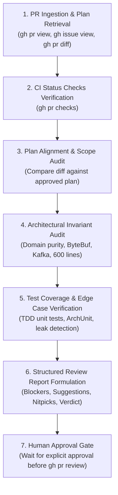

# Review PR #$PR_NUMBER

This skill guides the AI agent through the **Pull Request Review & Compliance** stage of Specification-Driven Development (SDD) in VoicePulse. It ensures that every PR is audited against its approved architectural plan, CI status checks, and the strict engineering invariants defined in [`AGENTS.md`](file:///home/antigravity/pedrazamiguez/voice-pulse/AGENTS.md) before merging.

---

## CRITICAL INVARIANTS

> [!IMPORTANT]
> **Human Approval Gate:**
> **NEVER** execute `gh pr review` autonomously.
> The agent **MUST** present the complete drafted review report (Verdict, Blockers, Suggestions, Nitpicks, and Markdown Body) in chat and wait for explicit human approval before submitting any review or approval to GitHub.

> [!IMPORTANT]
> **Plan-First Verification:**
> Every pull request must be linked to an approved issue and adhere strictly to the posted implementation plan. Any unapproved scope expansion or file addition must be flagged as a blocker unless accompanied by an approved `[SCOPE ADDENDUM]`.

---

## 1. 7-Step PR Review Protocol Workflow



---

## 2. Review Execution Steps

### Step 1: PR Ingestion & Plan Retrieval

1. **Retrieve PR Metadata:**
   Inspect PR title, description, branch targets, and modified files:
   ```bash
   gh pr view $PR_NUMBER --json number,title,body,headRefName,baseRefName,files,author
   ```

2. **Extract Linked Issue & Retrieve Approved Plan:**
   - Locate the parent issue identifier `#<id>` from the PR description (e.g., `closes #<id>`, `fixes #<id>`, `resolves #<id>`) or from the branch naming convention (`feature/VP-<id>-...`).
   - Fetch the authoritative implementation plan from the linked issue's comments:
     ```bash
     gh issue view <issue_id> --comments
     ```
   - **HALT CONDITION:** If no approved implementation plan exists on the issue, flag an immediate **Blocker** requiring the author to plan and obtain approval before PR review.

3. **Ingest Pull Request Diff:**
   ```bash
   gh pr diff $PR_NUMBER
   ```

---

### Step 2: CI Status Checks Verification

1. **Inspect GitHub Actions Status:**
   Query the check suites on the PR branch:
   ```bash
   gh pr checks $PR_NUMBER
   ```

2. **Validate Mandatory Workflows:**
   Verify the following CI workflows have executed and passed:
   - `build-and-test` (Unit and Testcontainers integration tests)
   - `static-analysis` (Spotless, Error Prone, SpotBugs, CPD, Checkstyle)
   - `coverage-and-architecture` (JaCoCo thresholds and ArchUnit rules)
   - `codeql` (Semantic AST security analysis)

3. **CI Assessment:**
   - Any failing (`fail`) or cancelled status check is a **Blocker**.
   - Pending status checks must be evaluated or waited on before approving.

---

### Step 3: Plan Alignment & Scope Audit

1. **Audit File Changes Against Plan:**
   - Cross-reference PR files against the declared `[NEW]` and `[MODIFY]` tables in the approved implementation plan.
   - Verify every promised file is implemented.
   - Detect undeclared files or unapproved scope expansion.
   - If undeclared changes exist, verify whether a valid `[SCOPE ADDENDUM]` was formally approved via `vp-follow-up` on the issue. If not, flag as a **Blocker**.

2. **Acceptance Criteria Verification:**
   - Verify that all acceptance criteria and deliverables specified in the issue description and plan are fully satisfied.

---

### Step 4: Architectural Invariant Audit ([`AGENTS.md`](file:///home/antigravity/pedrazamiguez/voice-pulse/AGENTS.md))

Auditors must enforce the following non-negotiable architectural rules:

1. **Domain Core Purity (Hexagonal Architecture):**
   - Pure domain models and use cases (`..domain..`) must have **zero framework dependencies**:
     - ❌ Forbidden: `org.springframework.*`, `io.netty.*`, `org.apache.kafka.*`, `jakarta.persistence.*`, `com.fasterxml.jackson.*`, `lombok.*`.
     - ✅ Permitted: Standard Java 21 standard library, pure domain records, sealed interfaces.
   - Ports must reside in `..domain.ports.inbound` (`*UseCase`) or `..domain.ports.outbound` (`*Port`).

2. **Java 21 Conventions & Concurrency:**
   - Immutable value objects and events must be declared as Java `record`.
   - Domain states and event hierarchies must use `sealed interface` with exhaustive pattern matching.
   - Heavy/blocking I/O must use Virtual Threads (`Executors.newVirtualThreadPerTaskExecutor()`), never blocking Netty event loops.

3. **Netty ByteBuf Memory Safety:**
   - Every Netty `ByteBuf` allocated or received must be explicitly released in a `finally` block:
     ```java
     try {
         // Process buffer
     } finally {
         ReferenceCountUtil.release(byteBuf);
     }
     ```
   - Buffers forwarded downstream must be retained explicitly (`byteBuf.retain()`) with verified downstream release.

4. **Kafka Partitioning Mandate:**
   - Every Kafka event produced to `telephony.calls.raw` and `telephony.calls.control` must partition strictly with message key `callId.toString()`.

5. **600-Line File Size Ceiling:**
   - No production Java source file may exceed 600 lines (`wc -l <file>`). Any file nearing 500 lines must extract collaborators.

6. **Code Hygiene & Best Practices:**
   - Zero field injection (No `@Autowired` on fields; constructor injection only. Use Lombok `@RequiredArgsConstructor` with `@NonNull` on required fields in infrastructure classes; pure standard Java constructors in domain).
   - No wildcard imports (`import java.util.*;` is prohibited).
   - Structured SLF4J logging only (No `System.out.println()` or `System.err.println()`. Use Lombok `@Slf4j` on infrastructure classes; prohibit manual `LoggerFactory.getLogger` boilerplate).
   - Zero property constants & fail-fast binding: `@ConfigurationProperties` records must not define fallback constants; compact constructors must validate and throw `IllegalArgumentException` on invalid values.
   - Zero nested classes in production code: Every helper, state machine, tracker, or collaborator must reside in its own top-level `.java` file for isolated unit testability.
   - Strict SRP & method sizing: Classes must not combine coordinator/registry duties with algorithmic state machines. Private methods must not exceed trivial helper complexity.
   - Clean fallback beans: Use the GoF Null Object Pattern with `@Fallback` or `@ConditionalOnMissingBean` instead of anonymous lambdas inside `@Configuration`.

---

### Step 5: Test Coverage & Edge Cases

1. **TDD Layer Coverage:**
   - Verify pure domain unit tests (`*DomainTest`) test business logic with mock ports and no Spring context.
   - Verify ArchUnit tests (`ArchitectureTest`) validate architecture boundaries and zero Lombok domain contamination.
   - Verify integration tests run with `-Dio.netty.leakDetection.level=PARANOID`.

2. **Disruption Hotline Edge Cases ([RFC-0003](file:///home/antigravity/pedrazamiguez/voice-pulse/docs/rfcs/RFC-0003-VOICEPULSE.md)):**
   - 25-word brevity rule per conversational turn.
   - Acoustic NATO phonetic confirmation for 6-character PNRs.
   - Session disconnect, network glitch, and timeout handling.

---

### Step 6: Structured Review Report Formulation

Format the review findings in a structured Markdown report:

```markdown
# Pull Request Review: PR #$PR_NUMBER

## Summary
Brief description of the PR scope, linked issue (#<id>), and plan alignment status.

## 1. Plan Alignment & Deliverables
- [x] All planned files implemented
- [x] All acceptance criteria met
- [x] No undeclared scope creep / Approved addendum present

## 2. Invariant Compliance Audit
- [x] Domain Core Purity (Zero framework/Lombok imports)
- [x] Netty ByteBuf memory safety (Explicit release)
- [x] Kafka partition key (callId)
- [x] File line counts (All files <= 600 lines)
- [x] Dependency injection (Constructor injection only; @RequiredArgsConstructor in infrastructure)
- [x] Structured SLF4J logging (Zero System.out; @Slf4j in infrastructure)
- [x] Zero property constants & fail-fast configuration
- [x] Zero production nested classes (Top-level classes only)
- [x] Strict Single Responsibility Principle (SRP)

## 3. Findings

### 🚨 Blockers
- Issues that must be addressed before merging (invariant violations, test failures, unapproved scope).

### 💡 Suggestions
- Non-blocking enhancements, architecture simplifications, or test optimizations.

### 🔍 Nitpicks
- Minor typo fixes, naming polish, or documentation formatting.

## 4. Recommendation Verdict
**VERDICT:** [ APPROVE | REQUEST_CHANGES | COMMENT ]
```

---

### Step 7: Mandatory Human Approval Gate

1. **Present Drafted Review in Chat:**
   Output the full review report to the developer for inspection and alignment.

2. **Wait for Human Confirmation:**
   **NEVER** run `gh pr review` without explicit user consent.

3. **Submit Review Upon Approval:**
   Once confirmed by the developer, submit the review command:
   ```bash
   # For approval:
   gh pr review $PR_NUMBER --approve --body "<review-body>"

   # For change requests:
   gh pr review $PR_NUMBER --request-changes --body "<review-body>"

   # For informational comments:
   gh pr review $PR_NUMBER --comment --body "<review-body>"
   ```
