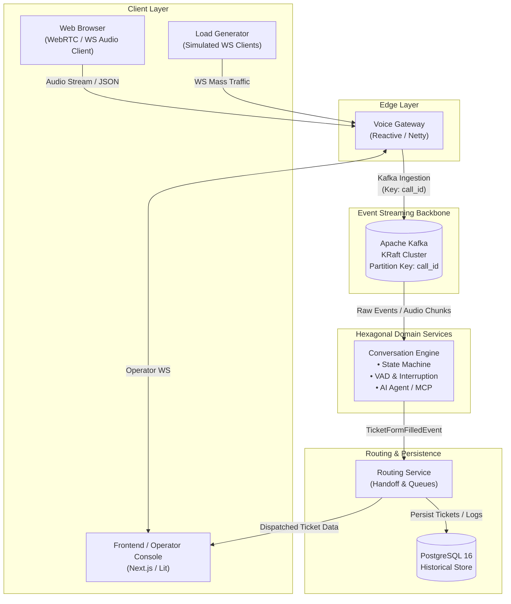

# VoicePulse: High-Throughput Event-Driven Voice Agent Platform

[](https://openjdk.org/projects/jdk/21/)
[](https://spring.io/projects/spring-boot)
[](docs/rfcs/RFC-0001-VOICEPULSE.md)
[](https://kafka.apache.org/)
[](LICENSE)

> VoicePulse is an enterprise-grade, distributed, event-driven voice orchestration and automated call center platform built to handle thousands of concurrent calls without connecting to expensive public telephony (PSTN) carriers. It automates customer data capture, synthesizes structured support tickets via tool calling, and executes seamless warm handoffs to human operators.

---

## 1. Executive Overview

Modern customer call centers face crushing demand during mass disruption events (e.g., severe weather flight cancellations). Traditional IVR systems force callers into rigid numeric menus, while commercial CPaaS platforms (Twilio, Telnyx) incur steep per-minute voice ingestion fees during high-scale load testing.

**VoicePulse solves this with a two-tier approach:**
1. **Zero-PSTN-Cost Voice Softphone:** An embedded browser-based softphone (`AudioWorkletNode` + WebSockets) streaming 16 kHz mono Linear PCM directly to a reactive edge gateway, enabling end-to-end voice and barge-in testing with zero telephony bills.
2. **High-Throughput Reactive & Event-Driven Backbone:** Strict separation between non-blocking Netty audio ingestion (I/O) and Hexagonal conversational state machines, backed by an Apache Kafka KRaft cluster partitioned strictly by `callId`.

---

## 2. System Architecture



### Core Technology Stack

| Layer | Technology | Key Responsibility |
|:---|:---|:---|
| **Edge Gateway** | Java 21 / Spring WebFlux (Netty) | Non-blocking WebSocket ingestion, binary PCM framing, backpressure defense |
| **Message Broker** | Apache Kafka 7.6+ (KRaft mode) | Partition-ordered audio chunks and signaling events (`call_id` key) |
| **Domain Engine** | Pure Java 21 (Hexagonal Architecture) | Sealed state machines, VAD energy detection, LLM function calling |
| **Session Cache** | Redis 7 (Alpine) | Active call routing, operator presence states, WebSocket connection maps |
| **Data Persistence**| PostgreSQL 16 (Alpine) | Disruption ticket persistence, JSONB form data, operator performance metrics |
| **Observability** | OpenTelemetry, Prometheus, Grafana | Distributed tracing, sub-second latency tracking, consumer lag monitoring |

---

## 3. Reference Business Scenario: International Airline Disruption Hotline

VoicePulse is validated against the high-load **SkyWay Airlines International Disruption Hotline** scenario ([RFC-0003](docs/rfcs/RFC-0003-VOICEPULSE.md)):

* **The Event:** Winter storm causes simultaneous cancellation of 14 transatlantic flights, routing 4,200 panicked passengers to customer support.
* **The Voice Bot Objective:**
  1. Identify caller and verify 6-character PNR booking reference via acoustic phonetic confirmation (NATO alphabet).
  2. Confirm canceled flight status via CRM lookup.
  3. Capture caller rebooking preferences (next available vs. full refund) and hotel accommodation needs.
  4. Fill out structured `AirlineDisruptionTicket` with zero operator manual data entry.
  5. Warm-handoff caller to a human operator with complete pre-populated context.
* **Conversational Brevity Rule:** The voice agent adheres to a **25-word maximum response limit** per turn to guarantee voice pacing, low latency, and natural turn-taking.

---

## 4. AI-First Development & The Meta-System

VoicePulse is architected for **Specification-Driven Development (SDD)** with local AI coding agents, dramatically cutting token consumption through AST symbol indexing and local documentation RAG ([RFC-0002](docs/rfcs/RFC-0002-VOICEPULSE.md)):

* **Passive Directives ([`AGENTS.md`](AGENTS.md)):** Strict architectural rules governing Domain Core purity, Java 21 records/sealed interfaces, Netty `ByteBuf` reference-counting safety, and Kafka partitioning mandates.
* **Modular Rule Sets ([`.agents/rules/`](.agents/rules/)):**
  - `01-hexagonal-architecture.md`
  - `02-java21-concurrency.md`
  - `03-netty-bytebuf-safety.md`
  - `04-kafka-partitioning.md`
* **Active Agent Skills ([`.agents/skills/`](.agents/skills/)):**
  - `vp-create-issue`: Ingests ideas and screenshots into structured, human-approved GitHub issues.
  - `vp-plan-issue`: Generates formal Hexagonal architectural specifications before touching code.
  - `vp-start-issue`: Enforces TDD implementation, 500-line pre-edit limits, and local verification.
  - `vp-follow-up`: Manages in-flight scope amendments (`[SCOPE ADDENDUM]`) and linked post-merge follow-up issues.
  - `vp-verify-architecture`: Runs ArchUnit bytecode tests and audits file sizes ($\le 600$ lines).
* **In-Repo Documentation RAG:** Local CPU ONNX vector database (`fastembed` + SQLite FTS5) providing sub-100ms semantic search over architecture docs with zero cloud API keys or external costs.
* **Automated Changelog ([`CHANGELOG.md`](CHANGELOG.md)):** Continuous Keep a Changelog updates committed automatically upon issue completion via GitHub Actions ([`docs/engineering/changelog-automation.md`](docs/engineering/changelog-automation.md)).
* **Release Pipeline & Delivery Lifecycle ([`docs/engineering/release-pipeline.md`](docs/engineering/release-pipeline.md)):** Automated GitFlow release management, branch target guardrails, release tagging, and post-release snapshot synchronization.

---

## 5. Multi-Module Project Structure

```
voice-pulse/
├── edge-gateway-service/       # Reactive WebFlux / Netty WebSocket audio streaming edge
├── conversation-engine/        # Hexagonal core state machine, VAD, and AI triage engine
├── routing-handoff-service/    # Operator queueing, Redis presence, and ticket persistence
├── shared-kernel/              # Pure domain value objects (call_id, pnr), sealed events
├── .agents/                    # AI agent directives, modular rules, and active skills
│   ├── rules/                  # Focused architectural and concurrency constraints
│   └── skills/                 # SDD workflow automation skills
├── docs/                       # Living documentation (Architecture, Domain, Engineering, RFCs, Plans)
│   ├── architecture/
│   ├── domain/
│   ├── engineering/
│   ├── plans/
│   └── rfcs/
├── scripts/                    # Automation scripts (pre-commit, RAG indexer, MCP servers)
├── docker-compose.infra.yml    # KRaft Kafka, Redis 7, and PostgreSQL 16
├── Makefile                    # Developer ergonomics CLI
├── CHANGELOG.md                # Automated Keep a Changelog release history
├── AGENTS.md                   # Foundational AI agent directives
└── pom.xml                     # Maven root build descriptor (Java 21 / Spring Boot 3.3.x)
```

---

## 6. Project Roadmap & Epics

The platform is engineered across 7 phase-gated epics. For detailed phase breakdowns, tracked GitHub issues, and execution plans, see [**ROADMAP.md**](ROADMAP.md).

| Epic | Focus Area | Status |
| :--- | :--- | :---: |
| **Epic 1** | [Engineering Foundation, Tooling, & Agentic Workflow Setup](docs/plans/epic-1-foundation-plan.md) | **Completed** |
| **Epic 2** | [Ingestion Voice Gateway & Softphone Echo Loop](docs/plans/epic-2-gateway-plan.md) | **In Progress** |
| **Epic 3** | High-Throughput Kafka Event Bus & In-Order Worker Pool | Planned |
| **Epic 4** | Hexagonal Conversation Core, VAD & State Machine | Planned |
| **Epic 5** | Runtime MCP Tool Servers & AI Triage Synthesis | Planned |
| **Epic 6** | Operator Handoff, Redis Presence & Web Console | Planned |
| **Epic 7** | 10,000 Concurrent Calls Load Testing & Performance Hardening | Planned |

---

## 7. Foundational RFC Documents

For in-depth technical blueprints, review the repository RFCs:
- **[RFC-0001: Architecture Strategy](docs/rfcs/RFC-0001-VOICEPULSE.md)** — Architectural pillars, network framing, streaming topology, and component contracts.
- **[RFC-0002: AI Engineering, Tooling & Automation Blueprint](docs/rfcs/RFC-0002-VOICEPULSE.md)** — Multi-agent taxonomy, SDD skills, local RAG indexer, ArchUnit rules, and Makefile.
- **[RFC-0003: Airline Disruption Hotline Scenario](docs/rfcs/RFC-0003-VOICEPULSE.md)** — SkyWay Airlines disruption business requirements, dialog flows, and ticket schemas.

---

## 8. Developer Quickstart

Once Epic 1 is provisioned:

```bash
# 1. First-time setup (provisions git hooks, local infra, and AI tooling)
make setup

# 2. Fast local verification (Spotless check + ArchUnit rules in < 15 seconds)
make fast-check

# 3. Spin up local backing containers (KRaft Kafka, Redis, Postgres)
make docker-infra

# 4. Run full project check
make check
```

---

## 9. License

VoicePulse is licensed under the Apache 2.0 License.
