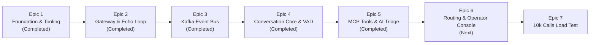

# VoicePulse Platform Roadmap

This document outlines the master multi-epic roadmap for the **VoicePulse** real-time voice AI telephony platform. Development follows **Specification-Driven Development (SDD)**, progressing across seven phase-gated epics anchored in our core architectural RFCs:
- **[RFC-0001: Architecture Strategy](docs/rfcs/RFC-0001-VOICEPULSE.md)** — Streaming topology, network framing, and Hexagonal boundaries.
- **[RFC-0002: AI Engineering, Tooling & Automation Blueprint](docs/rfcs/RFC-0002-VOICEPULSE.md)** — Multi-agent taxonomy, SDD skills, and local RAG.
- **[RFC-0003: Airline Disruption Hotline Scenario](docs/rfcs/RFC-0003-VOICEPULSE.md)** — High-load validation scenario for SkyWay Airlines.

---

## 1. Roadmap Status Overview

| Epic | Title | Target Module(s) | Status | Tracking / Plan |
| :--- | :--- | :--- | :---: | :--- |
| **Epic 1** | **Engineering Foundation, Tooling, & Agentic Workflow Setup** | Multi-module Root, `.agents/` | **Completed** | [Issue #9](https://github.com/pedrazamiguez/voice-pulse/issues/9) • [Plan](docs/plans/epic-1-foundation-plan.md) |
| **Epic 2** | **Ingestion Voice Gateway & Softphone Echo Loop** | `edge-gateway-service` | **Completed** | [Issue #20](https://github.com/pedrazamiguez/voice-pulse/issues/20) • [Plan](docs/plans/epic-2-gateway-plan.md) |
| **Epic 3** | **High-Throughput Kafka Event Bus & In-Order Worker Pool** | `edge-gateway-service`, `conversation-engine` | **Completed** | [Issue #68](https://github.com/pedrazamiguez/voice-pulse/issues/68) • [Plan](docs/plans/epic-3-kafka-plan.md) |
| **Epic 4** | **Hexagonal Conversation Core, VAD & State Machine** | `conversation-engine`, `shared-kernel` | **Completed** | [Issue #105](https://github.com/pedrazamiguez/voice-pulse/issues/105) • [Plan](docs/plans/epic-4-conversation-plan.md) |
| **Epic 5** | **Runtime MCP Tool Servers & AI Triage Synthesis** | `conversation-engine`, `shared-kernel`, `scripts/mcp` | **Completed** | [Issue #128](https://github.com/pedrazamiguez/voice-pulse/issues/128) • [Plan](docs/plans/epic-5-mcp-plan.md) |
| **Epic 6** | **Operator Handoff, Redis Presence & Web Console** | `routing-handoff-service`, `edge-gateway-service`, `shared-kernel` | **Next** | [Issue #140](https://github.com/pedrazamiguez/voice-pulse/issues/140) • [Plan](docs/plans/epic-6-routing-console-plan.md) |
| **Epic 7** | **10,000 Concurrent Calls Load Testing & Hardening** | Platform-wide, Gatling, OTel | Planned | RFC-0002 §12 & §13 |

---

## 2. Epic Breakdown & Execution Phases

---

### Epic 1: Engineering Foundation, Tooling, & Agentic Workflow Setup
* **Tracking Issue:** [#9](https://github.com/pedrazamiguez/voice-pulse/issues/9)
* **Master Plan:** [docs/plans/epic-1-foundation-plan.md](docs/plans/epic-1-foundation-plan.md)
* **Status:** **Completed**
* **Objective:** Establish multi-module Java 21 / Maven scaffolding, bytecode-level architectural enforcement with ArchUnit, local containerized infrastructure (Kafka KRaft, Redis, Postgres), unified developer ergonomics via `Makefile`, and the local AI meta-system.

#### Execution Phases:
- **Phase 0: Repository & Agentic Bootstrap**
  - Project vision and entrypoints (`README.md`).
  - Foundational directives ([`AGENTS.md`](AGENTS.md)) and modular rules (`.agents/rules/*`).
  - Active SDD agent skills (`.agents/skills/*`).
- **Phase 1: Code Scaffolding & Bytecode Enforcement**
  - Multi-module Maven POM structure (`shared-kernel`, `edge-gateway-service`, `conversation-engine`, `routing-handoff-service`).
  - ArchUnit tests enforcing Hexagonal architecture, zero field injection, and the 600-line ceiling.
  - Spotless Google Java Format (AOSP style, 4-space indent) and compiler static analysis.
- **Phase 2: Local Infrastructure & Unified DX**
  - Docker Compose backing services (`docker-compose.infra.yml`: Kafka KRaft 3.7, Redis 7, Postgres 16).
  - Unified `Makefile` (`make fast-check`, `make check`, `make format`).
  - Git pre-commit hooks enforcing formatting and architecture tests before commit.
- **Phase 3: Knowledge Retrieval & CI Automation**
  - Living architecture documentation and local CPU FastEmbed RAG vector database.
  - GitHub Actions CI multi-job pipeline (`.github/workflows/ci.yml`).

---

### Epic 2: Ingestion Voice Gateway & Softphone Echo Loop
* **Tracking Issue:** [#20](https://github.com/pedrazamiguez/voice-pulse/issues/20)
* **Master Plan:** [docs/plans/epic-2-gateway-plan.md](docs/plans/epic-2-gateway-plan.md)
* **Status:** **Completed**
* **Objective:** Deliver a functional, end-to-end, zero-PSTN audio loop featuring a reactive Netty WebFlux WebSocket edge gateway, paranoid `ByteBuf` reference counting safety, pure domain audio models, an embedded HTML5 `AudioWorklet` softphone client, and sub-100ms echo loopback verification.

#### Execution Phases:
- **Phase 1: Pure Domain Modeling & Port Contracts**
  - Immutable domain records (`AudioChunk`, `AudioFormat`, `CallSessionId`).
  - Pure domain aggregate (`CallSession`) tracking connection lifecycle.
  - Driving ports (`IngestAudioChunkUseCase`, `ManageCallSessionUseCase`).
  - Driven ports (`AudioFramePublisherPort`, `SessionRegistryPort`).
- **Phase 2: Reactive Netty WebSocket Handler & ByteBuf Safety**
  - Non-blocking `AudioWebSocketHandler` mapped to `/ws/calls/{callId}/audio`.
  - Frame size validation (DoS guard rejecting frames $> 64\text{ KB}$).
  - Explicit Netty `ReferenceCountUtil.release(byteBuf)` in `finally` blocks.
  - Unit tests with `-Dio.netty.leakDetection.level=PARANOID`.
- **Phase 3: Browser Softphone & AudioWorklet Interface**
  - Single-page responsive softphone UI served at `/` or `/softphone/index.html`.
  - Native `AudioWorkletProcessor` downsampling microphone input to 16 kHz Mono Linear PCM.
  - Bidirectional WebSocket streaming client with real-time audio playback.
  - Visual telemetry (connection state, VU meter, RTT HUD).
- **Phase 4: Loopback Audio Echo Adapter & Latency Tracking**
  - Thread-safe `ConcurrentSessionRegistry` managing active sessions.
  - Secondary outbound adapter `LoopbackAudioEchoAdapter` reflecting PCM chunks back to caller.
  - Microsecond timestamping to compute network round-trip time (RTT).
- **Phase 5: End-to-End WebSocket Integration & Paranoid Memory Gate**
  - `@SpringBootTest` end-to-end test streaming 5,000 synthetic PCM chunks.
  - Verification of in-order frame arrival, sub-100ms latency, and zero memory leaks.

---

### Epic 3: High-Throughput Kafka Event Bus & In-Order Worker Pool
* **Tracking Issue:** [#68](https://github.com/pedrazamiguez/voice-pulse/issues/68)
* **Master Plan:** [docs/plans/epic-3-kafka-plan.md](docs/plans/epic-3-kafka-plan.md)
* **Status:** **Completed**
* **Governing Blueprint:** RFC-0001 §3 & §4.2; RFC-0002 §4
* **Objective:** Transition from loopback echo to an asynchronous distributed event fabric using Apache Kafka KRaft.
* **Key Deliverables:**
  - `AudioChunkEnvelope` and zero-allocation binary serialization in `shared-kernel`.
  - `KafkaAudioFramePublisher` secondary adapter in `edge-gateway-service` streaming to `telephony.calls.raw`.
  - Partitioning mandate: Every audio and control event strictly keyed by `callId.toString()`.
  - Sequential, pinned worker pool consumer in `conversation-engine` preserving monotonic sequence numbers per call.
  - Reactive backpressure handling, dead-letter queue (`telephony.calls.dlq`), and consumer lag monitoring.
  - Multi-module Testcontainers integration test validating 5,000 frames under continuous streaming.

---

### Epic 4: Hexagonal Conversation Core, VAD & State Machine
* **Tracking Issue:** [#105](https://github.com/pedrazamiguez/voice-pulse/issues/105)
* **Master Plan:** [docs/plans/epic-4-conversation-plan.md](docs/plans/epic-4-conversation-plan.md)
* **Status:** **Completed**
* **Governing Blueprint:** RFC-0001 §4.3; RFC-0003 §3 & §4
* **Objective:** Build the conversational intelligence core orchestrating voice activity detection, barge-in evaluation, and the SkyWay Airlines disruption dialog flow.
* **Key Deliverables:**
  - Pure domain `CallSession` aggregate state machine with Java 21 sealed interfaces ([#99](https://github.com/pedrazamiguez/voice-pulse/issues/99)).
  - Real-time Voice Activity Detection (VAD) energy evaluation for immediate barge-in interruption ([#100](https://github.com/pedrazamiguez/voice-pulse/issues/100)).
  - 25-word maximum turn limit enforcement and acoustic NATO phonetic PNR verification ([#101](https://github.com/pedrazamiguez/voice-pulse/issues/101)).
  - Real-time barge-in detection and Kafka control signaling dispatcher ([#102](https://github.com/pedrazamiguez/voice-pulse/issues/102)).
  - Deterministic mock LLM processor providing sub-50ms responses for load testing ([#103](https://github.com/pedrazamiguez/voice-pulse/issues/103)).
  - End-to-end multi-module conversational dialog and barge-in integration test with Testcontainers ([#104](https://github.com/pedrazamiguez/voice-pulse/issues/104)).

---

### Epic 5: Runtime MCP Tool Servers & AI Triage Synthesis
* **Tracking Issue:** [#128](https://github.com/pedrazamiguez/voice-pulse/issues/128)
* **Master Plan:** [docs/plans/epic-5-mcp-plan.md](docs/plans/epic-5-mcp-plan.md)
* **Status:** **Completed**
* **Governing Blueprint:** RFC-0001 §4.4; RFC-0002 §6; RFC-0003 §4
* **Objective:** Connect the conversational core to external systems via Model Context Protocol (MCP) tool servers for real-world airline operations.
* **Key Deliverables:**
  - Pure domain MCP tool models, outbound port contracts, and `TicketFormFilledEvent` Kafka envelope ([#122](https://github.com/pedrazamiguez/voice-pulse/issues/122)).
  - `mcp-crm-server`: Passenger lookup, frequent flyer tier, and disrupted flight itinerary adapter with MapStruct mappers ([#123](https://github.com/pedrazamiguez/voice-pulse/issues/123)).
  - `mcp-ticket-server`: Structured `AirlineDisruptionTicket` submission and `telephony.tickets.intent` Kafka publisher ([#124](https://github.com/pedrazamiguez/voice-pulse/issues/124)).
  - `mcp-telephony-routing`: Priority skill group routing policy and operator queue transfer adapter ([#125](https://github.com/pedrazamiguez/voice-pulse/issues/125)).
  - Dual-mode AI triage synthesis engine (live LLM tool-calling + deterministic sub-50ms mock processor) ([#126](https://github.com/pedrazamiguez/voice-pulse/issues/126)).
  - End-to-end MCP tool servers and Kafka ticket intent integration test with Testcontainers & WireMock ([#127](https://github.com/pedrazamiguez/voice-pulse/issues/127)).

---

### Epic 6: Operator Handoff, Redis Presence & Web Console
* **Tracking Issue:** [#140](https://github.com/pedrazamiguez/voice-pulse/issues/140)
* **Master Plan:** [docs/plans/epic-6-routing-console-plan.md](docs/plans/epic-6-routing-console-plan.md)
* **Status:** **Next**
* **Governing Blueprint:** RFC-0001 §3, §4.2, §4.5; RFC-0003 §2 & §4
* **Objective:** Provide seamless human-in-the-loop escalation when automated triage concludes or customer requests an agent.
* **Key Deliverables:**
  - Pure domain handoff state machine, outbound ports, and `OperatorRerouteSignal` (`shared-kernel`, `routing-handoff-service`) ([#142](https://github.com/pedrazamiguez/voice-pulse/issues/142)).
  - PostgreSQL 16 ticket & handoff audit persistence (`disruption_tickets`, `operator_handoff_logs`) via Virtual Threads and MapStruct ([#143](https://github.com/pedrazamiguez/voice-pulse/issues/143)).
  - Reactive Redis 7 skill-based operator queues, presence tracking, and TTL heartbeat mechanism ([#144](https://github.com/pedrazamiguez/voice-pulse/issues/144)).
  - Kafka `telephony.tickets.intent` consumer and automated operator assignment engine ([#145](https://github.com/pedrazamiguez/voice-pulse/issues/145)).
  - Operator Web Console displaying pre-populated disruption ticket, priority queue, and live transcript ([#146](https://github.com/pedrazamiguez/voice-pulse/issues/146)).
  - Low-latency bot-to-human audio stream handoff in `edge-gateway-service` verified under `PARANOID` leak detection ([#147](https://github.com/pedrazamiguez/voice-pulse/issues/147)).

---

### Epic 7: 10,000 Concurrent Calls Load Testing & Performance Hardening
* **Status:** **Planned**
* **Governing Blueprint:** RFC-0002 §12 & §13; RFC-0001 §5
* **Objective:** Validate platform resilience and latency SLAs under severe storm surge traffic.
* **Key Deliverables:**
  - Gatling load simulation orchestrating 10,000 concurrent synthetic WebSocket callers.
  - OpenTelemetry distributed tracing and metrics export.
  - Prometheus and Grafana dashboards tracking p95/p99 audio packet latency and Kafka consumer lag.
  - Resource usage profiling under load (heap, direct memory, CPU).

---

## 3. Governance & Invariants

All epic execution strictly adheres to the directives in [`AGENTS.md`](AGENTS.md):
- **Hexagonal Purity:** Domain cores remain 100% free of Spring, Netty, Kafka, Jackson, or JPA imports.
- **Memory Safety:** Every Netty `ByteBuf` is explicitly released with paranoid leak detection enabled.
- **File Length Limits:** No Java source file exceeds 600 lines of code.
- **Zero Field Injection:** All dependencies injected via explicit constructors.
- **Verification Gates:** Changes must pass `make fast-check` (Spotless + ArchUnit) prior to pull request submission.
