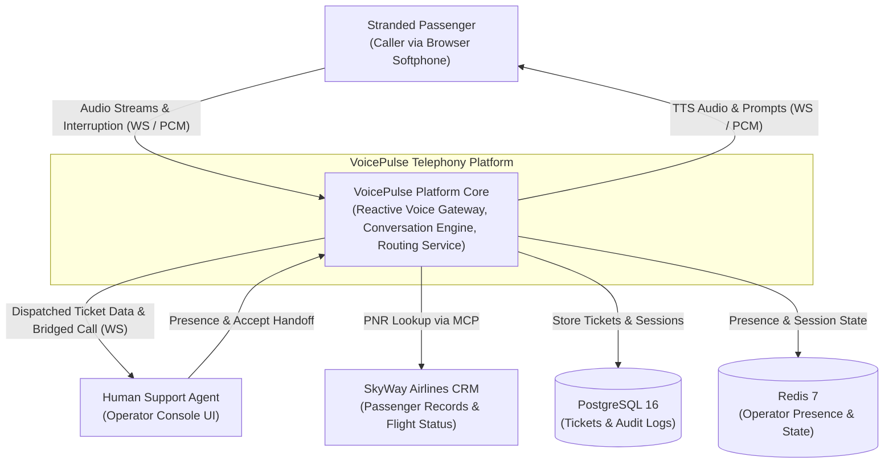
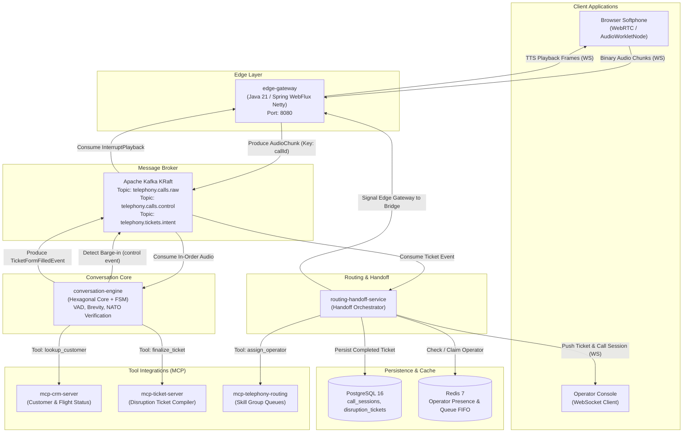

# C4 System Architecture & Container Diagrams

> [!IMPORTANT]
> **Source of Truth:** Defines C4 Level 1 (System Context) and C4 Level 2 (Container Architecture) for VoicePulse.

---

## 1. C4 Level 1: System Context Diagram

The VoicePulse platform ingests real-time bidirectional audio streams, conducts automated triage using conversational AI, and hands off structured tickets and bridged audio to human customer support operators.

---

## 2. C4 Level 2: Container Diagram

---

## 3. Container Responsibilities & Technology Stack

| Container | Technology | Responsibilities |
| :--- | :--- | :--- |
| **`edge-gateway`** | Java 21, Spring Boot 3 WebFlux, Netty | WebSocket connection pooling, 16 kHz PCM binary framing, Netty Direct Memory safety (`ByteBuf`), low-latency audio buffer flushing. |
| **`Apache Kafka (KRaft)`** | Kafka 3.7+ (ZooKeeper-less) | Strict partitioned in-order event streaming keyed on `callId`. Audio chunk transport and control signaling. |
| **`conversation-engine`** | Java 21 Hexagonal Core | Finite State Machine, VAD energy detection, 25-word brevity validator, acoustic phonetic verification, MCP client. |
| **`routing-handoff-service`** | Java 21, Spring Boot 3 | Consumes completed disruption tickets, coordinates tiered skill routing, manages operator presence in Redis, persists to PostgreSQL. |
| **`Redis 7`** | Redis (Alpine) | In-memory operator availability states, real-time queue position counters, and active call routing cache. |
| **`PostgreSQL 16`** | PostgreSQL (Alpine) | Historical relational persistence with GIN-indexed JSONB for variable flight disruption payloads. |
