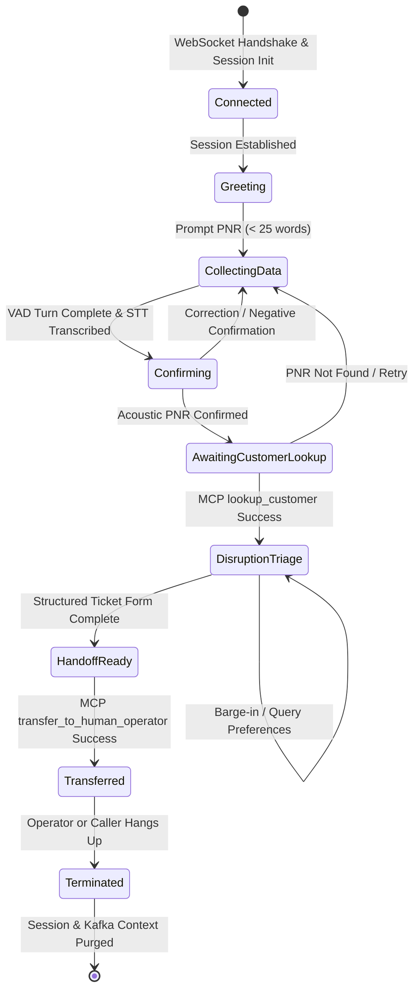

# Disruption Hotline Conversational State Machine

> [!IMPORTANT]
> **Source of Truth:** Defines the finite state machine (FSM), state transitions, and Java 21 sealed interface hierarchy for the **SkyWay Airlines International Disruption Hotline** ([RFC-0003](../rfcs/RFC-0003-VOICEPULSE.md)).

---

## 1. Conversational Lifecycle Overview

The call session progresses through deterministic states managed by the Conversation Engine's Hexagonal domain core. Every state change is driven by incoming domain events (audio transcription, acoustic confirmation, barge-in, or MCP tool responses).



---

## 2. Java 21 Sealed State Representation

In accordance with `AGENTS.md` §2, the domain state machine uses Java 21 `sealed interface` and immutable `record` implementations for exhaustive pattern matching:

```java
package com.voicepulse.conversation.domain.model;

import java.time.Instant;

public sealed interface CallSessionState permits
    CallSessionState.Connected,
    CallSessionState.Greeting,
    CallSessionState.CollectingPassengerDetails,
    CallSessionState.AwaitingBookingConfirmation,
    CallSessionState.DisruptionTriage,
    CallSessionState.HandoffReady,
    CallSessionState.Transferred,
    CallSessionState.Terminated {

    record Connected(Instant connectedAt) implements CallSessionState {}

    record Greeting(Instant greetedAt) implements CallSessionState {}

    record CollectingPassengerDetails(int attemptCount) implements CallSessionState {}

    record AwaitingBookingConfirmation(String transcribedPnr, Instant promptedAt) implements CallSessionState {}

    record DisruptionTriage(
        String pnr,
        String customerName,
        String flightNumber,
        Instant triagedAt
    ) implements CallSessionState {}

    record HandoffReady(String ticketId, String targetSkillGroup) implements CallSessionState {}

    record Transferred(String operatorId, Instant transferredAt) implements CallSessionState {}

    record Terminated(String reason, Instant terminatedAt) implements CallSessionState {}
}
```

---

## 3. Conversational State Machine Transitions

### 1. `Connected` -> `Greeting`
* **Trigger:** Voice Gateway establishes inbound WebSocket connection and emits `CallSessionStartedEvent`.
* **System Prompt (TTS):** *"Welcome to the Airline Disruption Hotline. To quickly assist you, please state your six-character booking reference or PNR."* (19 words).

### 2. `Greeting` -> `CollectingPassengerDetails` -> `AwaitingBookingConfirmation`
* **Trigger:** Caller speaks alphanumeric sequence. VAD detects trailing silence (500ms). STT transcribes raw string (e.g., `A8F9X2`).
* **Acoustic Phonetic Prompt:** *"I heard Alpha-8-Foxtrot-9-Xray-2. Is that correct?"* (8 words).

### 3. `AwaitingBookingConfirmation` -> `DisruptionTriage`
* **Trigger:** Caller confirms affirmatively ("Yes").
* **MCP Action:** Conversation Engine invokes `lookup_customer(pnr: "A8F9X2")` via `mcp-crm-server`.
* **System Response:** *"I see your flight SW-104 was cancelled due to weather. Would you like the next available flight or a hotel accommodation?"* (20 words).

### 4. `DisruptionTriage` -> `HandoffReady`
* **Trigger:** Passenger indicates preferences (e.g., *"I need a hotel for tonight"*).
* **MCP Action:** Invokes `finalize_ticket` via `mcp-ticket-server`, creating an immutable `AirlineDisruptionTicket`.
* **Kafka Event:** Emits `TicketFormFilledEvent` to topic `telephony.tickets.intent` partitioned by `callId`.

### 5. `HandoffReady` -> `Transferred`
* **Trigger:** Routing service assigns available human operator from Redis skill queue.
* **System Prompt:** *"I have prepared your hotel request. Transferring you to our priority disruption team now."* (14 words).
* **System Action:** Voice Gateway bridges audio stream to Operator Console WebSocket.

### 6. `Transferred` -> `Terminated`
* **Trigger:** Call completed or hung up (`CallSessionEndedEvent`).
* **Cleanup:** In-memory Netty ByteBuf queues flushed; Redis call presence key expired; final audit record written to PostgreSQL.
