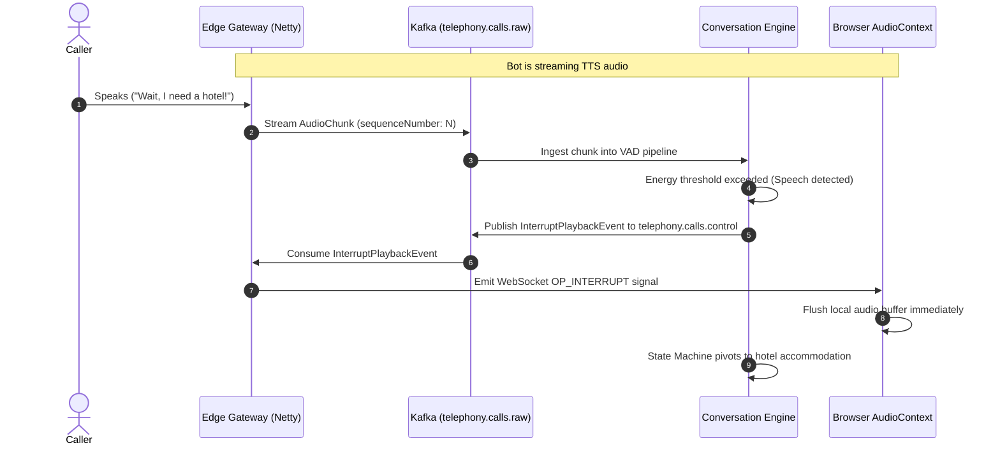

# Telephony Invariants & Acoustic Guardrails

> [!IMPORTANT]
> **Source of Truth:** This document defines the inviolable real-time telephony constraints, audio framing invariants, and acoustic pacing standards for VoicePulse. All conversational triage agents, prompts, and audio processing pipelines must adhere to these rules.

---

## 1. The 25-Word Brevity Rule

* **Invariant:** The automated voice triage agent MUST adhere to a **strict 25-word maximum limit per conversational turn**.
* **Rationale:** 
  - In telephony voice systems, long monologues degrade conversational pacing, increase Time-to-First-Audio (TTFA) latency, and cause cognitive overload for stressed callers.
  - Short, crisp questions encourage immediate caller responses, minimize barge-in collisions, and allow rapid conversational steering.
* **Violation Guardrail:** Prompts and conversational engine output validators must truncate or reject generated turns exceeding 25 words.

---

## 2. Acoustic Phonetic Verification for PNRs

* **Invariant:** Passenger Name Records (PNR booking references — 6 alphanumeric characters) MUST be acoustically verified using standard **NATO Phonetic Spelling** (or unambiguous digit-by-digit confirmation).
* **Rationale:** Over noisy cellular or PSTN audio channels, phonetically similar letters (e.g., 'B' vs. 'D', 'P' vs. 'T', 'M' vs. 'N') have high error rates with raw Speech-to-Text (STT) models.
* **Verification Protocol:**
  1. Caller utters PNR (e.g., "A 8 F 9 X 2").
  2. STT transcribes raw alphanumeric sequence: `A8F9X2`.
  3. Voice agent prompts acoustic confirmation: *"I heard Alpha-8-Foxtrot-9-Xray-2. Is that correct?"*
  4. Only upon affirmative confirmation does the state machine advance to CRM customer lookup.

---

## 3. Audio Stream Ingestion & Framing Specifications

VoicePulse processes real-time audio streams between the Edge Gateway and downstream Kafka topics using standardized binary chunk specifications:

| Parameter | Specification | Notes |
| :--- | :--- | :--- |
| **Encoding** | Linear PCM (`AUDIO_PCM_16KHZ`) | Uncompressed signed 16-bit little-endian (LE) |
| **Sampling Rate** | 16,000 Hz (16 kHz) or 8,000 Hz (8 kHz) | 16 kHz default for WebRTC / WebSocket softphone |
| **Channels** | Single channel (Mono) | Reduces bandwidth and processing overhead |
| **Frame Duration** | 20 ms per packet | Industry telephony standard for low latency |
| **Chunk Size** | 320 samples = 640 bytes (at 16 kHz) | Monotonically sequenced chunks |

### Audio Frame Kafka Envelope
```json
{
  "callId": "c9a4d812-78d1-47fa-bf87-9bc40efb8911",
  "sequenceNumber": 421,
  "timestamp": 1730789045120,
  "payloadType": "AUDIO_PCM_16KHZ",
  "data": "<base64_pcm_chunk>"
}
```

---

## 4. Voice Activity Detection (VAD) & Barge-in Interruption

Real-time natural conversations require seamless interruption handling (barge-in):



* **VAD Energy Threshold:** Evaluates RMS energy and speech probability over sliding 20ms frames.
* **Trailing Silence Detection:** 500 ms of contiguous silence marks conversational turn completion from caller.
* **Immediate Flush:** Upon barge-in detection, the edge gateway and softphone client flush queued TTS audio buffers within **< 50 ms**.

---

## 5. Model Context Protocol (MCP) Boundary

* **Zero Direct Database Writes:** The conversational AI triage engine NEVER executes direct JDBC, SQL, or persistence writes.
* **Tool Invocation:** All real-world actions are mediated through decoupled Model Context Protocol (MCP) tools:
  - `mcp-crm-server`: PNR validation and customer itinerary retrieval.
  - `mcp-ticket-server`: Validates and submits structured `AirlineDisruptionTicket` payloads.
  - `mcp-telephony-routing`: Operator availability checks and queue assignment.

---

## 6. Zero-Cloud-Cost PSTN-Free Softphone

VoicePulse bypasses commercial telephony carriers (Twilio, Telnyx) during development and automated verification:
* **Browser Softphone:** Uses native `navigator.mediaDevices.getUserMedia()` via an `AudioWorkletNode`.
* **Client Downsampling:** Audio is resampled client-side to 16 kHz Linear PCM mono.
* **Binary WebSocket:** Frames stream directly to the Spring WebFlux Netty edge gateway with zero per-minute billing.
