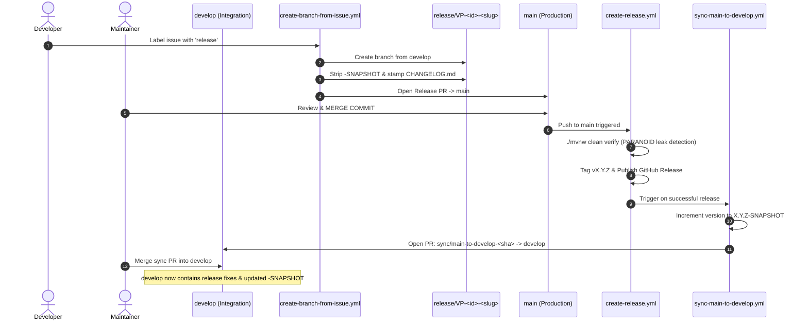

# VoicePulse Release Pipeline & Branch Lifecycle

> [!IMPORTANT]
> **Source of Truth:** This document specifies the automated GitFlow release lifecycle, branch naming invariants, build verification gates, and post-release synchronization mechanisms for VoicePulse.

---

## 1. Release Lifecycle Architecture

VoicePulse uses a strict, automated GitFlow delivery pipeline aligned with [RFC-0001](../../docs/rfcs/RFC-0001-VOICEPULSE.md) and [RFC-0002](../../docs/rfcs/RFC-0002-VOICEPULSE.md).



---

## 2. Branch Routing & PR Target Matrix

Every pull request is strictly validated by `.github/workflows/enforce-branch-naming.yml`:

| Branch Pattern | Base Branch | Permitted PR Targets | Auto-PR Created? | Purpose | PR Labels Applied |
| :--- | :--- | :--- | :---: | :--- | :--- |
| `release/VP-*` | `develop` | `main` ONLY | Yes | Planned production release | `release` (+ `major` if breaking) |
| `hotfix/VP-*` | `main` | `main` ONLY | No | Urgent production patch | `hotfix` |
| `feature/VP-*` | `develop` | `develop` ONLY | No | Feature development | `enhancement` |
| `bugfix/VP-*` | `develop` | `develop` ONLY | No | Bug fixes during development | `bug` |
| `refactor/VP-*` | `develop` | `develop` ONLY | No | Architecture & refactoring | `enhancement` |
| `internal/VP-*` | `develop` | `develop` ONLY | No | Tooling, scripts & CI/CD | `tooling` |
| `docs/VP-*` | `develop` | `develop` ONLY | No | Documentation additions/updates | `documentation` |
| `sync/main-to-develop-*` | `main` | `develop` ONLY | Yes | Post-release sync back-merge | `sync` |
| `dependabot/*`, `copilot/*` | system | `develop` or `main` | - | Automated dependencies | `dependencies` |

Legacy prefixes (`feat/`, `fix/`) and direct pushes to `develop` or `main` are rejected locally and in CI.

---

## 3. Human Gate & Merge Commit Mandate for `main`

> [!CAUTION]
> **Merge Commit Mandate:** Merges into `main` (releases and hotfixes) **MUST strictly use "Create a merge commit"**. Never use "Squash and merge" or "Rebase and merge".

### Why Squash Merges are Prohibited on `main`:
1. **Accurate Tag Ancestry:** Squashing rewrites commit hashes, detaching the tag ancestry from `develop` and corrupting automated changelog diffing.
2. **Clean Back-Merge Sync:** When `sync/main-to-develop-<sha>` opens a back-merge PR against `develop`, git cleanly detects the common ancestor if a true merge commit was used. A squashed commit causes duplicate commit noise and merge conflicts.

---

## 4. Automated Workflows Reference

1. **`create-branch-from-issue.yml`**: Provisions branches on demand when issues receive triggering labels. For `release`, it strips `-SNAPSHOT`, stamps `CHANGELOG.md`, commits, and opens the PR targeting `main`.
2. **`enforce-branch-naming.yml`**: Validates head branch name format and destination branch targets on all pull requests. Auto-applies standard labels.
3. **`create-release.yml`**: Executes `./mvnw clean verify -Dio.netty.leakDetection.level=PARANOID` on `main`, generates categorized release notes from `CHANGELOG.md`, tags `vX.Y.Z`, and creates a GitHub Release.
4. **`sync-main-to-develop.yml`**: Triggers upon release publication, bumps the Maven multi-module versions to the next `-SNAPSHOT` iteration, initializes a fresh `[Unreleased]` changelog section, and opens `sync/main-to-develop-<sha>` targeting `develop`.
5. **`cancel-stale-pr-runs.yml`**: Immediately cancels queued or in-flight validation workflows when a pull request is merged or closed, conserving GitHub Actions runner resources.

---

## 5. Automated PR Authentication & CI Triggering (`PAT_TOKEN`)

When automated workflows open `release/*` or `sync/main-to-develop-*` pull requests using the default `GITHUB_TOKEN` (`github-actions[bot]`), GitHub Actions treats the actor as a restricted bot/non-collaborator and halts required `pull_request` workflows (`Build and Test`, `Static Analysis`, `Coverage and Architecture`, `SonarQube Analysis & Quality Gate`, and `Enforce Branch Naming & Targets`) with `conclusion: "action_required"` ("This workflow requires approval from a maintainer") or suppresses downstream workflow triggers.

To eliminate manual workflow approval prompts:
1. **Token Resolution (`${{ secrets.PAT_TOKEN || secrets.AUTOMATION_TOKEN || secrets.GITHUB_TOKEN }}`):**
   - Both `create-branch-from-issue.yml` and `sync-main-to-develop.yml` pass `${{ secrets.PAT_TOKEN || secrets.AUTOMATION_TOKEN || secrets.GITHUB_TOKEN }}` to `actions/checkout@v4` (`token:`) and `actions/github-script@v7` (`github-token:`).
   - When `PAT_TOKEN` (or `AUTOMATION_TOKEN`) is configured in the repository secrets, branch creation, git pushes, and `pulls.create` API calls execute under the repository maintainer identity, immediately triggering all 5 `pull_request` CI workflows without manual approval gates.
   - If neither secret is configured, the workflows gracefully fall back to `secrets.GITHUB_TOKEN`.
2. **Sync Commit CI Execution (No `[skip ci]`):**
   - `sync-main-to-develop.yml` intentionally omits `[skip ci]` from the `chore(sync): bump version to <snapshotVersion> and initialize unreleased changelog` commit message so required `pull_request` status checks execute automatically on back-merge PRs targeting `develop`.
3. **Personal Access Token Configuration:**
   - **Classic PAT (`PAT_TOKEN`):** Configure with `repo` (full control of repositories, commit statuses, and pull requests) and `workflow` (permits pushing `sync/main-to-develop-*` commits when release diffs include `.github/workflows/*` changes).
   - **Fine-Grained PAT (`PAT_TOKEN` or `AUTOMATION_TOKEN`):** Configure repository permissions with `Contents: Read and write`, `Pull requests: Read and write`, `Issues: Read and write`, and `Workflows: Read and write`.

---

## 6. Local Verification Commands

```bash
# Run release and changelog automation test suite
make test-changelog

# Run ArchUnit and Spotless fast-check
make fast-check

# Verify multi-module build with paranoid Netty leak detection
./mvnw clean verify -Dio.netty.leakDetection.level=PARANOID
```
