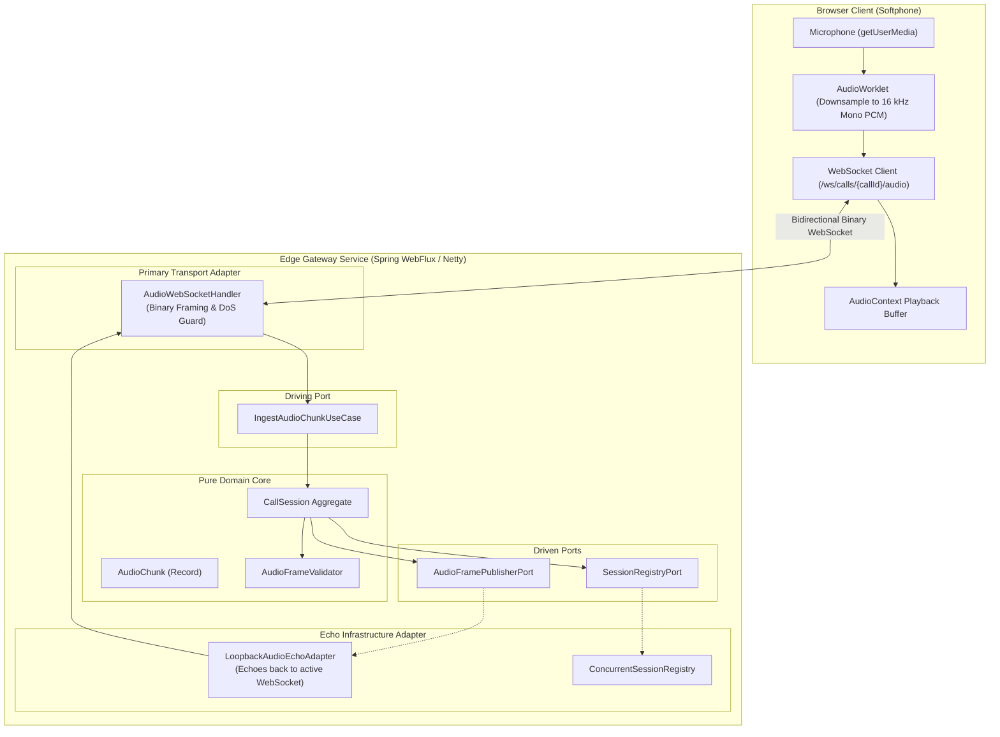
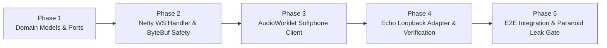

# Epic 2: Ingestion Voice Gateway & Softphone Echo Loop

## 1. Executive Summary & Objective

Based on the architectural specifications defined in **[RFC-0001](../rfcs/RFC-0001-VOICEPULSE.md)** (§2 & §4.1) and **[RFC-0002](../rfcs/RFC-0002-VOICEPULSE.md)** (§3), **Epic 2** establishes the high-throughput, non-blocking ingestion edge of VoicePulse.

The objective of Epic 2 is to deliver a functional, end-to-end, zero-PSTN audio loop:
1. **Edge Gateway Service (`edge-gateway-service`)**: Reactive Netty WebFlux pipeline streaming raw binary audio frames over bidirectional WebSockets (`/ws/calls/{callId}/audio`).
2. **ByteBuf Memory Safety**: Strict reference counting (`ReferenceCountUtil.release`) guaranteeing zero direct memory leaks under `-Dio.netty.leakDetection.level=PARANOID`.
3. **Hexagonal Domain Boundaries**: Clean separation between pure domain audio modeling/ports and Netty transport adapters.
4. **Browser-Based Softphone Client**: Embedded single-page interface leveraging HTML5 `AudioWorkletNode` to capture microphone input, downsample client-side to 16 kHz Mono Linear PCM, and stream binary frames to the gateway with real-time audio playback.
5. **Bidirectional Echo Verification**: Proves sub-100ms audio round-trip latency, frame sequencing, and backpressure defense before connecting the Apache Kafka broker in Epic 3.

---

## 2. Architecture & Data Flow

---

## 3. Implementation Phases & Tracked GitHub Issues

The implementation follows Specification-Driven Development (SDD), progressing from pure domain contracts to Netty reactive infrastructure, client UI, and integration testing:

### Phase 1: Pure Domain Modeling & Port Contracts
* **Goal**: Establish framework-free domain aggregates, value objects, and port interfaces in `edge-gateway-service`.
* **Deliverables**:
  - `AudioChunk`: Immutable record containing `CallSessionId`, `sequenceNumber`, `timestamp`, `pcmData` (`byte[]`), and `audioFormat`.
  - `AudioFormat`: Enum/record defining sample rate (16000 Hz, 8000 Hz), bit depth (16-bit), and channel count (mono).
  - `CallSession`: Pure domain aggregate tracking session status (`CONNECTED`, `STREAMING`, `DISCONNECTED`).
  - `IngestAudioChunkUseCase` & `ManageCallSessionUseCase`: Inbound driving ports.
  - `AudioFramePublisherPort` & `SessionRegistryPort`: Outbound driven ports.
  - Domain unit tests verifying invariant enforcement and frame ordering.

### Phase 2: Reactive Netty WebSocket Handler & ByteBuf Safety
* **Goal**: Scaffolding the Spring WebFlux Netty WebSocket endpoint with DoS defense and zero memory leaks.
* **Deliverables**:
  - `AudioWebSocketHandler`: Non-blocking handler mapped to `/ws/calls/{callId}/audio`.
  - Frame size validation (reject frames $> 64\text{ KB}$ with policy violation code 1009).
  - Binary audio extraction with deterministic `ReferenceCountUtil.release(byteBuf)` in `finally` block.
  - Netty unit/mock tests running with `-Dio.netty.leakDetection.level=PARANOID`.

### Phase 3: Browser Softphone & AudioWorklet Interface
* **Goal**: Deliver a zero-cost browser softphone for human voice and barge-in testing.
* **Deliverables**:
  - HTML5/CSS single-page responsive UI served at `/` or `/softphone/index.html`.
  - `audio-processor.worklet.js`: Native `AudioWorkletProcessor` downsampling microphone input to 16 kHz Mono Linear PCM (Int16Array).
  - Bidirectional WebSocket streaming client with automatic reconnect and ping/pong keepalive.
  - Audio playback queue using Web Audio API `AudioContext` for glitch-free continuous streaming.
  - Visual telemetry: Connection state, audio level VU meter, and round-trip latency HUD.

### Phase 4: Loopback Audio Echo Adapter & Latency Tracking
* **Goal**: Wire the inbound stream back to the outbound WebSocket connection to complete the audio circuit.
* **Deliverables**:
  - `ConcurrentSessionRegistry`: Thread-safe, non-blocking registry managing active `WebSocketSession` references by `CallSessionId`.
  - `LoopbackAudioEchoAdapter`: Secondary outbound adapter implementing `AudioFramePublisherPort` that reflects received PCM chunks back to the caller.
  - Microsecond timestamping on frames to calculate real-time network round-trip time (RTT).

### Phase 5: End-to-End WebSocket Integration & Paranoid Memory Gate
* **Goal**: Automated end-to-end regression test suite verifying audio fidelity, throughput, and memory safety.
* **Deliverables**:
  - Spring Boot `@SpringBootTest(webEnvironment = RANDOM_PORT)` integration test using Netty `ReactorNettyWebSocketClient`.
  - Stream 5,000 synthetic 20ms PCM audio chunks, verifying in-order reception and zero packet drop.
  - Assert zero memory leak warnings under `-Dio.netty.leakDetection.level=PARANOID`.
  - Spotless formatting and ArchUnit verification.

---

## 4. Inviolable Constraints & Architectural Directives (AGENTS.md)

1. **Domain Purity**: `edge-gateway-service/src/main/java/com/voicepulse/gateway/domain` MUST NOT import `io.netty.*`, `org.springframework.*`, or any transport classes.
2. **ByteBuf Reference Counting**: Every allocated or sliced `ByteBuf` in Netty pipeline handlers MUST be explicitly released via `ReferenceCountUtil.release()` inside a `finally` block.
3. **No Blocking in Netty Workers**: Netty event loop threads must never block on synchronous I/O or `Thread.sleep()`.
4. **600-Line Source Limit**: All Java classes must remain well below 600 lines.
5. **Acoustic Fidelity**: Standard format is strictly 16 kHz, 16-bit signed Linear PCM, mono channel (32,000 bytes/sec).

---

## 5. Definition of Done (DoD) for Epic 2

1. **Softphone Usability**: Navigating to `http://localhost:8081/` in Chrome/Firefox opens the softphone, requests mic permission, and streams bidirectional voice.
2. **Audible Echo Loop**: User speaking into microphone hears their own voice echoed back clearly within $< 100\text{ ms}$ latency.
3. **Zero Memory Leaks**: Full Maven integration test runs cleanly with `-Dio.netty.leakDetection.level=PARANOID` without logging any `LEAK:` errors.
4. **ArchUnit Compliance**: All architectural and package boundary checks pass with `make fast-check`.
5. **CI Green**: All sub-tasks merged into `develop` with passing GitHub Actions workflows.
