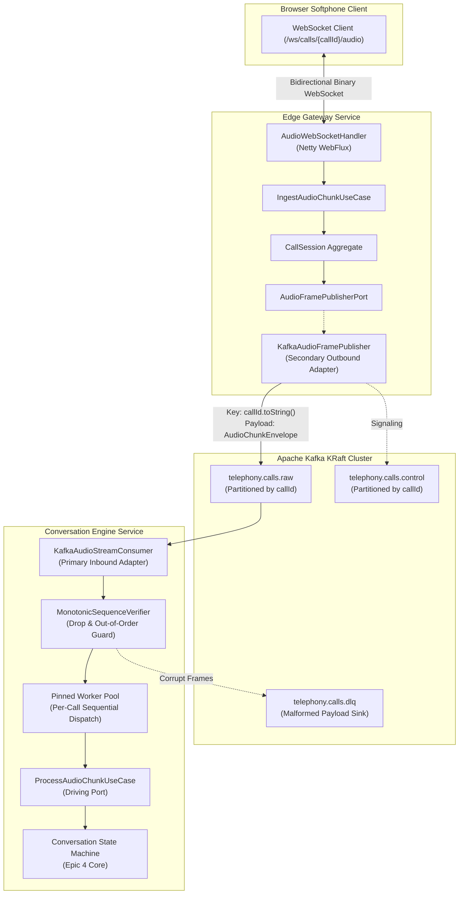
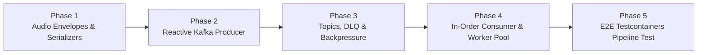

# Epic 3: High-Throughput Kafka Event Bus & In-Order Worker Pool

* **Tracking Issue:** [#68](https://github.com/pedrazamiguez/voice-pulse/issues/68)
* **Status:** **Active / In Progress**

## 1. Executive Summary & Objective

Based on the architectural specifications defined in **[RFC-0001](../rfcs/RFC-0001-VOICEPULSE.md)** (§3 & §4.2) and **[RFC-0002](../rfcs/RFC-0002-VOICEPULSE.md)** (§1.3 & §4), **Epic 3** transitions VoicePulse from the local loopback echo edge adapter to an asynchronous, distributed event fabric powered by **Apache Kafka KRaft**.

The primary objective of Epic 3 is to establish resilient, low-latency event-driven communication between the ingestion gateway (`edge-gateway-service`) and the conversational intelligence core (`conversation-engine`):
1. **Event Envelopes & Zero-Allocation Serialization (`shared-kernel`)**: Pure Java records representing audio chunks and signaling control events, serialized efficiently without framework contamination in domain cores.
2. **Reactive Kafka Producer Adapter (`edge-gateway-service`)**: Secondary outbound adapter implementing `AudioFramePublisherPort` that publishes incoming binary audio frames to `telephony.calls.raw` with non-blocking backpressure.
3. **Partition Key Mandate**: Every event published to `telephony.calls.raw` and `telephony.calls.control` MUST use `callId.toString()` as the Kafka message key, guaranteeing strict partition affinity.
4. **In-Order Sequential Consumer Pool (`conversation-engine`)**: Primary inbound adapter consuming `telephony.calls.raw` that processes audio chunks per call in strict monotonic sequence without inter-thread race conditions.
5. **Backpressure & Dead-Letter Routing**: Circuit-breaking and DLQ routing (`telephony.calls.dlq`) to isolate corrupted or malformed payloads without halting partition consumption.
6. **Multi-Module Testcontainers Verification**: An end-to-end integration test orchestrating an Apache Kafka KRaft container, streaming 5,000 continuous frames from gateway to conversation engine with 100% sequence continuity and zero frame loss.

---

## 2. Architecture & Data Flow

---

## 3. Implementation Phases & Planned GitHub Sub-Issues

### Phase 1: Event Envelopes & Kafka Serializers (`shared-kernel`) — [#63](https://github.com/pedrazamiguez/voice-pulse/issues/63)
- **Objective:** Establish the common event vocabulary and efficient serialization for Kafka streaming.
- **Deliverables:**
  - `AudioChunkEnvelope`: Immutable record with `CallId`, `sequenceNumber`, `timestamp`, `AudioFormat`, and raw payload.
  - `CallControlEnvelope`: Sealed interface for signaling (`CallStarted`, `CallTerminated`, `BargeInInterrupt`).
  - Native binary/JSON Kafka `Serializer` and `Deserializer` implementations in `shared-kernel` infrastructure.
  - Unit tests verifying serialization round-trip fidelity, payload validation, and byte efficiency.

### Phase 2: Reactive Kafka Producer Adapter (`edge-gateway-service`) — [#64](https://github.com/pedrazamiguez/voice-pulse/issues/64)
- **Objective:** Stream incoming audio frames from the Netty gateway to Kafka.
- **Deliverables:**
  - `KafkaAudioFramePublisher`: Outbound secondary adapter implementing `AudioFramePublisherPort`.
  - Enforce partition key mandate: `ProducerRecord<>(topic, callId.toString(), envelope)`.
  - Non-blocking reactive integration using Spring Kafka / Reactor Kafka without blocking Netty event-loop threads.
  - Unit tests with mocked Kafka producer verifying partition keys, monotonic sequences, and error propagation.

### Phase 3: Kafka Topics, Dead-Letter Queue & Backpressure Configuration — [#65](https://github.com/pedrazamiguez/voice-pulse/issues/65)
- **Objective:** Provision broker topology and define resilient failure policies.
- **Deliverables:**
  - Spring Kafka topic declarations: `telephony.calls.raw`, `telephony.calls.control`, and `telephony.calls.dlq`.
  - Retention configuration tailored for low-latency streaming (short retention window).
  - Dead-letter publish recoverer routing malformed or unparseable payloads to `telephony.calls.dlq`.
  - Producer backpressure configuration (buffer memory limits, timeout handling).

### Phase 4: In-Order Sequential Consumer Pool (`conversation-engine`) — [#66](https://github.com/pedrazamiguez/voice-pulse/issues/66)
- **Objective:** Ingest audio frames sequentially per call in the conversation engine.
- **Deliverables:**
  - `KafkaAudioStreamConsumer`: Inbound primary adapter consuming `telephony.calls.raw`.
  - `MonotonicSequenceVerifier`: Validates monotonic continuity (`seq = 0, 1, 2...`) per `callId`, alerting on dropped or duplicated frames.
  - Pinned worker pool executor ensuring chunks for the same `callId` are executed in strict sequential order.
  - Unit tests asserting per-call in-order execution and sequence discontinuity detection.

### Phase 5: End-to-End Testcontainers Pipeline Verification — [#67](https://github.com/pedrazamiguez/voice-pulse/issues/67)
- **Objective:** Prove 100% reliable streaming from WebSocket edge through Kafka into conversation engine.
- **Deliverables:**
  - Multi-module `@SpringBootTest` spinning up Kafka KRaft via Testcontainers.
  - Stream 5,000 synthetic 20ms PCM chunks through the gateway producer into Kafka.
  - Assert conversation engine receives all 5,000 chunks with zero frame loss, 100% payload integrity, and monotonic sequence preservation.
  - Verify consumer lag stays within strict SLA (< 50ms processing lag).

---

## 4. Architectural Invariants & Guardrails

1. **Domain Core Purity:** Absolutely no `org.apache.kafka.*` or Spring Kafka annotations in `domain..` packages. Kafka logic resides exclusively in `infrastructure.kafka..`.
2. **Partition Key Invariant:** Every record published to `telephony.calls.raw` and `telephony.calls.control` MUST use `callId.toString()` as the key.
3. **Event Loop Non-Blocking:** Never perform synchronous blocking `future.get()` inside Netty WebFlux pipelines.
4. **Monotonic Sequence Enforcement:** Every audio chunk must increment monotonically; out-of-order chunks must be flagged or re-sequenced before reaching domain state machines.
5. **File Ceiling & Formatting:** Zero source files over 600 lines, Google Java Format applied via Spotless.
