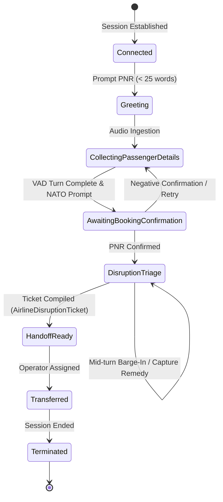
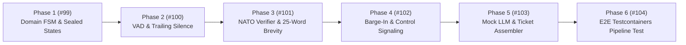

# Epic 4: Hexagonal Conversation Core, VAD & State Machine

* **Tracking Issue:** [#105](https://github.com/pedrazamiguez/voice-pulse/issues/105)
* **Status:** **Completed**

## 1. Executive Summary & Objective

Based on the architectural specifications defined in **[RFC-0001](../rfcs/RFC-0001-VOICEPULSE.md)** (§4.3) and the **[RFC-0003](../rfcs/RFC-0003-VOICEPULSE.md)** SkyWay Airlines Disruption Hotline scenario, **Epic 4** delivers the conversational intelligence core within `conversation-engine`.

The primary objective of Epic 4 is to establish a deterministic, high-throughput conversational dialogue pipeline capable of processing real-time telephony streams ingested via Apache Kafka:
1. **Pure Domain State Machine & Sealed States (`domain.statemachine`)**: Pure Java 21 sealed interface `CallSessionState` and aggregate root (`ConversationSession`) orchestrating call session lifecycles without framework contamination.
2. **Real-Time Voice Activity Detection (VAD)**: Root Mean Square (RMS) frame energy calculation over 16 kHz Mono Linear PCM 20ms chunks (320 samples / 640 bytes) with a sliding window detector identifying 500ms trailing silence turn completions.
3. **Acoustic NATO Phonetic Verification & 25-Word Brevity Rule**: Strict validation of the 25-word maximum turn limit and bidirectional NATO phonetic translation for acoustic PNR verification (`A8F9X2` <-> `Alpha-8-Foxtrot-9-Xray-2`).
4. **Real-Time Barge-In Detection & Kafka Control Dispatcher**: Detection of caller speech energy during agent TTS playback, emitting `BargeInInterrupt` to `telephony.calls.control` strictly keyed by `callId.toString()` for sub-50ms playback buffer purging.
5. **Deterministic Mock LLM Conversation Engine**: Sub-50ms simulation processor parsing incoming passenger utterances via regex and heuristics, assembling the structured `AirlineDisruptionTicket` domain model without external cloud LLM costs.
6. **Multi-Module Testcontainers Pipeline Verification**: End-to-end integration test orchestrating an Apache Kafka KRaft container, streaming simulated caller chunks, verifying turn completions, acoustic verification, mid-stream barge-in interruption, and ticket completion.

---

## 2. Architecture & Conversational Flow

---

## 3. Implementation Phases & Planned GitHub Sub-Issues

### Phase 1: Pure Domain CallSession State Machine & Sealed States — [#99](https://github.com/pedrazamiguez/voice-pulse/issues/99)
- **Objective:** Establish the pure domain conversational state machine and port contracts.
- **Deliverables:**
  - `CallSessionState`: Java 21 `sealed interface` with records (`Connected`, `Greeting`, `CollectingPassengerDetails`, `AwaitingBookingConfirmation`, `DisruptionTriage`, `HandoffReady`, `Transferred`, `Terminated`).
  - `ConversationSession`: Pure aggregate root encapsulating transition validation and extracted entities.
  - Domain events: `CallStateTransitioned`, `TurnCompleted`, `BargeInDetected`.
  - Driving ports: `ProgressConversationUseCase`, `ProcessCallControlUseCase`.
  - Driven ports: `ConversationStatePublisherPort`, `CallControlDispatcherPort`.
  - Pure domain unit tests with Instancio validating exhaustive pattern matching and transition guards.

### Phase 2: Real-Time Voice Activity Detection & Trailing Silence Evaluator — [#100](https://github.com/pedrazamiguez/voice-pulse/issues/100)
- **Objective:** Ingest 16 kHz Mono Linear PCM 20ms chunks and detect speech vs. silence boundaries.
- **Deliverables:**
  - `VoiceActivityDetector`: Pure domain DSP service computing RMS energy on 16-bit little-endian PCM frames.
  - `VadThresholdConfig`: Parameterized configuration record defining energy thresholds and timing windows.
  - `TrailingSilenceEvaluator`: Sliding window evaluator detecting 500 ms contiguous silence for turn completion.
  - `VadEvaluationResult`: Value record indicating frame energy, speech detected status, and turn boundary flag.
  - Unit tests with synthetic PCM audio streams (silence, white noise, pure tone bursts, speech bursts).

### Phase 3: Acoustic NATO Phonetic PNR Verifier & 25-Word Brevity Guardrail — [#101](https://github.com/pedrazamiguez/voice-pulse/issues/101)
- **Objective:** Implement airline hotline acoustic verification and conversational brevity invariants.
- **Deliverables:**
  - `NatoPhoneticAlphabet`: Pure domain dictionary and translator for NATO phonetic tokens.
  - `AcousticPnrVerifier`: Translates 6-character PNRs to acoustic confirmation prompts and parses transcribed phonetic words into normalized PNRs.
  - `TurnBrevityValidator`: Enforces strict 25-word maximum limit per conversational turn, rejecting or truncating violations.
  - Unit tests covering all alphanumeric permutations and boundary edge cases.

### Phase 4: Real-Time Barge-In Detection & Kafka Control Signaling Dispatcher — [#102](https://github.com/pedrazamiguez/voice-pulse/issues/102)
- **Objective:** React immediately to caller speech during agent playback and purge audio queues.
- **Deliverables:**
  - `BargeInEvaluator`: Triggers interruption when speech energy is detected during active agent playback.
  - `CallControlDispatcherPort`: Driven outbound port for signaling events.
  - `KafkaCallControlDispatcher`: Secondary outbound adapter publishing `BargeInInterrupt` to `telephony.calls.control` strictly keyed by `callId.toString()`.
  - Edge gateway listener consuming `BargeInInterrupt` and purging Netty audio buffers within < 50ms.
  - Unit and Kafka integration tests verifying non-blocking delivery and partition key adherence.

### Phase 5: Deterministic Mock LLM Conversation Engine & Disruption Ticket Assembler — [#103](https://github.com/pedrazamiguez/voice-pulse/issues/103)
- **Objective:** Deliver sub-50ms conversational simulation and compile structured tickets.
- **Deliverables:**
  - `MockLlmConversationProcessor`: Deterministic dialog simulator parsing utterances via regex/heuristics.
  - Context-aware response generator adhering strictly to the 25-word limit with < 50ms latency.
  - `DisruptionTicketAssembler`: Compiles validated passenger data into `AirlineDisruptionTicket`.
  - `ConversationOrchestratorService`: Application service implementing `ProcessAudioChunkUseCase` (superseding `NoOpProcessAudioChunkUseCase`), integrating VAD, FSM, and Mock LLM.
  - Unit tests verifying multi-turn dialogue progression and ticket assembly.

### Phase 6: End-to-End Conversational Dialog & Barge-In Integration Test with Testcontainers — [#104](https://github.com/pedrazamiguez/voice-pulse/issues/104)
- **Objective:** Validate the complete conversational pipeline under containerized Kafka KRaft streaming.
- **Deliverables:**
  - Multi-component `@SpringBootTest` spinning up Apache Kafka KRaft via Testcontainers.
  - Streams 20ms PCM audio chunks to `telephony.calls.raw`.
  - Drives complete multi-turn dialogue (Greeting -> PNR -> NATO verification -> disruption triage -> ticket assembly).
  - Simulates mid-stream caller barge-in during bot playback, asserting `BargeInInterrupt` published to `telephony.calls.control`.
  - Asserts zero sequence loss, partition key integrity, zero memory leaks, and sub-50ms turn processing latency.

---

## 4. Architectural Invariants & Guardrails

1. **Domain Core Purity:** Zero imports of Spring, Netty, Kafka, Jackson, JPA, Lombok, or MapStruct in `domain..` packages.
2. **Partition Key Mandate:** Every event produced to `telephony.calls.raw` and `telephony.calls.control` MUST use `callId.toString()` as the Kafka message key.
3. **25-Word Brevity Rule:** Voice triage agent responses MUST NEVER exceed 25 words per turn.
4. **Acoustic Phonetic Verification:** 6-character PNR booking references must be acoustically verified using standard NATO phonetic spelling before advancing to triage.
5. **Memory Safety & Non-Blocking I/O:** Audio frame handling remains strictly non-blocking with zero direct memory leaks.
6. **File Ceiling & Formatting:** Zero source files over 600 lines, formatted via Google Java Format (`./mvnw spotless:check`).
