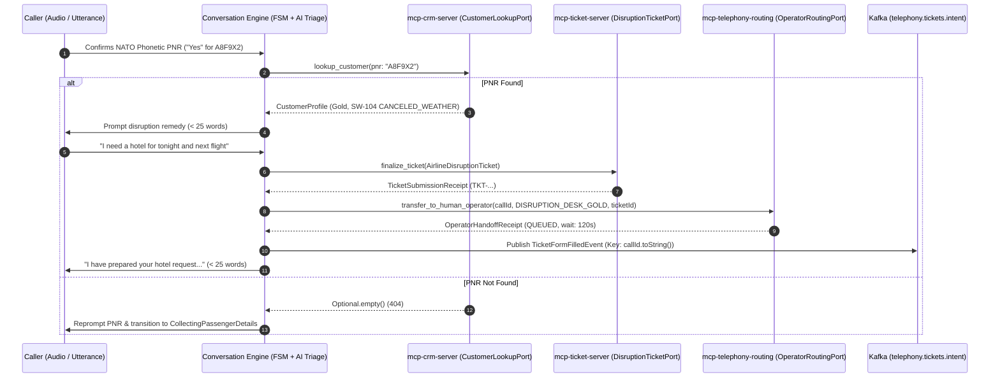

# Epic 5: Runtime MCP Tool Servers & AI Triage Synthesis

* **Tracking Issue:** [#128](https://github.com/pedrazamiguez/voice-pulse/issues/128)
* **Status:** **Next**

## 1. Executive Summary & Objective

Based on the architectural specifications defined in **[RFC-0001](../rfcs/RFC-0001-VOICEPULSE.md)** (§4.4), **[RFC-0002](../rfcs/RFC-0002-VOICEPULSE.md)** (§6 & §9.3), and the **[RFC-0003](../rfcs/RFC-0003-VOICEPULSE.md)** SkyWay Airlines Disruption Hotline scenario, **Epic 5** connects the Hexagonal conversational core in `conversation-engine` to external airline systems via **Model Context Protocol (MCP)** tool servers and implements dual-mode AI triage synthesis.

The primary objective of Epic 5 is to bridge pure domain conversational state transitions with real-world tool execution and downstream Kafka event publishing while preserving 100% Hexagonal domain purity:
1. **Pure Domain MCP Tool Models, Outbound Ports & `TicketFormFilledEvent` (`shared-kernel`, `conversation-engine`)**: Pure Java 21 domain records (`CustomerProfile`, `ActiveItinerary`, `TicketSubmissionReceipt`, `OperatorQueueStatus`, `OperatorHandoffReceipt`), outbound driven ports (`CustomerLookupPort`, `DisruptionTicketPort`, `OperatorRoutingPort`, `TicketIntentPublisherPort`), and the `TicketFormFilledEvent` Kafka envelope for `telephony.tickets.intent`.
2. **`mcp-crm-server` Runtime Adapter & MapStruct Mapper**: Secondary outbound adapter (`McpCrmClientAdapter`) executing `lookup_customer` over Java 21 Virtual Threads (`Executors.newVirtualThreadPerTaskExecutor()`), compile-time MapStruct DTO transformation (`McpCrmMapper` in `infrastructure.mcp.mapper`), fail-fast `@ConfigurationProperties`, and local MCP server (`scripts/mcp/mcp_crm_server.py`).
3. **`mcp-ticket-server` Runtime Adapter & Kafka Ticket Intent Dispatcher**: Secondary outbound adapter (`McpTicketClientAdapter`) invoking `finalize_ticket`, `KafkaTicketIntentPublisher` publishing `TicketFormFilledEvent` to `telephony.tickets.intent` strictly keyed by `callId.toString()`, and local MCP server (`scripts/mcp/mcp_ticket_server.py`).
4. **`mcp-telephony-routing` Runtime Adapter & Priority Skill Group Resolver**: Pure domain `SkillGroupRoutingPolicy` mapping passenger frequent flyer tiers and accessibility flags to target operator queues (`DISRUPTION_DESK_GOLD`, `DISRUPTION_DESK_ACCESSIBILITY`, `DISRUPTION_DESK_PRIORITY`, `DISRUPTION_DESK_STANDARD`), `McpRoutingClientAdapter` (`check_queue_status`, `transfer_to_human_operator`), and local MCP server (`scripts/mcp/mcp_telephony_routing_server.py`).
5. **Dual-Mode AI Triage Synthesis Engine**: Configurable conversational processor supporting both deterministic sub-50ms simulation (`MockLlmConversationProcessor`) for 10,000-call load tests and live LLM tool-calling inference (`LiveLlmConversationProcessor`) with strict 25-word brevity enforcement and PNR not-found retry loops (`AwaitingBookingConfirmation` -> `CollectingPassengerDetails`).
6. **End-to-End Testcontainers & WireMock Pipeline Verification**: Multi-component `@SpringBootTest` validating multi-turn dialogue, MCP tool invocation, PNR not-found recovery, and `telephony.tickets.intent` Kafka streaming under `-Dio.netty.leakDetection.level=PARANOID`.

---

## 2. Architecture & MCP Tool Orchestration Flow

---

## 3. Implementation Phases & Planned GitHub Sub-Issues

### Phase 1: Pure Domain MCP Tool Models, Outbound Ports & `TicketFormFilledEvent` — [#122](https://github.com/pedrazamiguez/voice-pulse/issues/122)
- **Objective:** Establish the pure Hexagonal domain models and outbound port contracts for external MCP tool invocations alongside the `TicketFormFilledEvent` Kafka envelope.
- **Deliverables:**
  - `TicketFormFilledEvent`, `TicketFormFilledEventSerializer`, and `TicketFormFilledEventDeserializer` in `shared-kernel`.
  - Pure domain records in `conversation-engine`: `FrequentFlyerTier`, `ActiveItinerary`, `CustomerProfile`, `TicketSubmissionReceipt`, `OperatorQueueStatus`, `OperatorHandoffReceipt`.
  - Outbound driven ports: `CustomerLookupPort`, `DisruptionTicketPort`, `OperatorRoutingPort`, `TicketIntentPublisherPort`.
  - Top-level GoF Null Object fallback beans (`@Fallback @Component`) in `infrastructure.fallback`.
  - Pure domain unit tests with Instancio and serializer round-trip tests.

### Phase 2: `mcp-crm-server` Runtime Adapter, MapStruct Mapper & Customer Lookup Client — [#123](https://github.com/pedrazamiguez/voice-pulse/issues/123)
- **Objective:** Implement the `mcp-crm-server` outbound adapter (`lookup_customer`) over Java 21 Virtual Threads with compile-time MapStruct DTO mapping.
- **Deliverables:**
  - `McpClientProperties` (`@ConfigurationProperties(prefix = "voicepulse.conversation.mcp")`) with `@DefaultValue` and fail-fast validation.
  - `McpCustomerLookupRequestDto`, `McpCustomerLookupResponseDto`, and `McpActiveItineraryDto` records in `infrastructure.mcp.dto`.
  - `McpCrmMapper` (`@Mapper(componentModel = "spring", unmappedTargetPolicy = ReportingPolicy.ERROR)`) in `infrastructure.mcp.mapper`.
  - `McpCrmClientAdapter` implementing `CustomerLookupPort` over `Executors.newVirtualThreadPerTaskExecutor()`.
  - `scripts/mcp/mcp_crm_server.py` standalone local MCP tool server.
  - Unit and WireMock integration tests (`McpCrmClientAdapterWireMockTest`).

### Phase 3: `mcp-ticket-server` Runtime Adapter & Kafka Ticket Intent Publisher — [#124](https://github.com/pedrazamiguez/voice-pulse/issues/124)
- **Objective:** Implement the `mcp-ticket-server` outbound adapter (`finalize_ticket`) and the `KafkaTicketIntentPublisher` streaming `TicketFormFilledEvent` to `telephony.tickets.intent`.
- **Deliverables:**
  - `McpFinalizeTicketRequestDto`, `McpExtractedEntitiesDto`, and `McpFinalizeTicketResponseDto` records in `infrastructure.mcp.dto`.
  - `McpTicketMapper` (`unmappedTargetPolicy = ReportingPolicy.ERROR`) in `infrastructure.mcp.mapper`.
  - `McpTicketClientAdapter` implementing `DisruptionTicketPort` over Virtual Threads.
  - `KafkaTicketIntentPublisher` implementing `TicketIntentPublisherPort`, publishing `TicketFormFilledEvent` to `telephony.tickets.intent` strictly keyed by `callId.toString()`.
  - `scripts/mcp/mcp_ticket_server.py` standalone local MCP tool server.
  - Unit, Mockito, and WireMock integration tests.

### Phase 4: `mcp-telephony-routing` Runtime Adapter & Priority Skill Group Resolver — [#125](https://github.com/pedrazamiguez/voice-pulse/issues/125)
- **Objective:** Implement pure domain priority skill group resolution and the `mcp-telephony-routing` outbound adapter (`check_queue_status`, `transfer_to_human_operator`).
- **Deliverables:**
  - `SkillGroupRoutingPolicy`: Pure domain service resolving operator department (`DISRUPTION_DESK_GOLD`, `DISRUPTION_DESK_ACCESSIBILITY`, `DISRUPTION_DESK_PRIORITY`, `DISRUPTION_DESK_STANDARD`).
  - `McpQueueStatusResponseDto`, `McpTransferRequestDto`, and `McpTransferResponseDto` records in `infrastructure.mcp.dto`.
  - `McpRoutingMapper` (`unmappedTargetPolicy = ReportingPolicy.ERROR`) in `infrastructure.mcp.mapper`.
  - `McpRoutingClientAdapter` implementing `OperatorRoutingPort` over Virtual Threads.
  - `scripts/mcp/mcp_telephony_routing_server.py` standalone local MCP tool server.
  - Pure domain unit tests and WireMock integration tests.

### Phase 5: Dual-Mode AI Triage Synthesis & MCP Tool Orchestration — [#126](https://github.com/pedrazamiguez/voice-pulse/issues/126)
- **Objective:** Wire MCP outbound ports into conversational state transitions and provide dual-mode turn synthesis (`mock` simulation vs `live` LLM tool-calling inference).
- **Deliverables:**
  - `ConversationDialogProcessorPort` strategy contract and fail-fast `AiInferenceProperties` (`voicepulse.conversation.ai`).
  - Enhance `MockLlmConversationProcessor` and `ConversationOrchestratorService` to invoke `CustomerLookupPort` on PNR confirmation (transitioning back to `CollectingPassengerDetails` if PNR is not found) and invoke `DisruptionTicketPort`, `OperatorRoutingPort`, and `TicketIntentPublisherPort` on triage completion.
  - `LiveLlmConversationProcessor` invoking configured LLM tool-calling endpoints over Virtual Threads while enforcing the strict 25-word maximum turn limit (`TurnBrevityValidator`).
  - Unit and WireMock tests verifying tool-calling orchestration, PNR not-found retry transitions, 25-word brevity enforcement, and < 50ms mock mode latency.

### Phase 6: End-to-End MCP Tool Servers & Kafka Ticket Intent Integration Test — [#127](https://github.com/pedrazamiguez/voice-pulse/issues/127)
- **Objective:** Validate the complete Epic 5 runtime MCP tool orchestration and Kafka event pipeline end-to-end with Testcontainers and WireMock.
- **Deliverables:**
  - `EndToEndMcpTriageIntegrationTest` spinning up Apache Kafka KRaft via Testcontainers and WireMock HTTP MCP servers (`mcp-crm-server`, `mcp-ticket-server`, `mcp-telephony-routing`).
  - Validates full happy path (audio ingestion -> NATO PNR confirmation -> CRM lookup -> ticket compilation -> operator queue transfer -> `TicketFormFilledEvent` on `telephony.tickets.intent` keyed by `callId.toString()`).
  - Validates unknown PNR 404 recovery loop (`AwaitingBookingConfirmation` -> `CollectingPassengerDetails` -> retry).
  - Validates live LLM mode tool calling and 25-word brevity enforcement under `-Dio.netty.leakDetection.level=PARANOID`.

---

## 4. Architectural Invariants & Guardrails

1. **Domain Core Purity:** Zero imports of Spring, Netty, Kafka, Jackson, JPA, Lombok, or MapStruct in `domain..` packages.
2. **MCP Boundary:** The conversational engine NEVER executes direct database writes; all CRM, ticket, and routing operations execute strictly through outbound ports (`..domain.ports.outbound`).
3. **Compile-Time MapStruct Mapping:** All DTO-to-domain transformations reside in `infrastructure.mcp.mapper` with `unmappedTargetPolicy = ReportingPolicy.ERROR`. Inline `new ObjectMapper()` and reflection mapping are strictly forbidden.
4. **Virtual Thread Concurrency:** Blocking HTTP/MCP client calls are offloaded to Java 21 Virtual Threads (`Executors.newVirtualThreadPerTaskExecutor()`).
5. **Partition Key Mandate:** Every event produced to `telephony.calls.raw`, `telephony.calls.control`, and `telephony.tickets.intent` MUST use `callId.toString()` as the Kafka message key.
6. **25-Word Brevity & Acoustic Verification:** Voice triage responses MUST NEVER exceed 25 words per turn, and 6-character PNRs must be acoustically confirmed via NATO phonetics prior to CRM lookup.
7. **File Ceiling & Formatting:** Zero source files over 600 lines, formatted via Google Java Format (`./mvnw spotless:check`).
