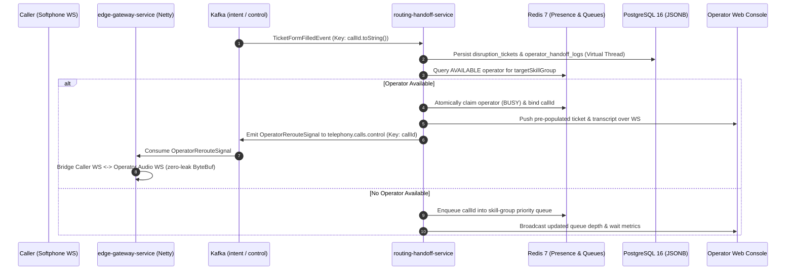
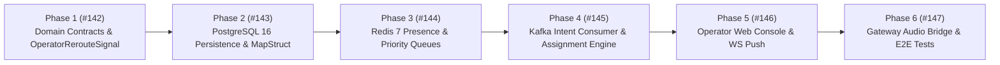

# Epic 6: Operator Handoff, Redis Presence & Web Console

* **Tracking Issue:** [#140](https://github.com/pedrazamiguez/voice-pulse/issues/140)
* **Status:** **Next**

## 1. Executive Summary & Objective

Based on the architectural specifications defined in **[RFC-0001](../rfcs/RFC-0001-VOICEPULSE.md)** (§3, §4.2, §4.5) and the **[RFC-0003](../rfcs/RFC-0003-VOICEPULSE.md)** SkyWay Airlines Disruption Hotline scenario, **Epic 6** delivers human-in-the-loop escalation in `routing-handoff-service`, `edge-gateway-service`, and `shared-kernel`, connecting automated AI triage (`telephony.tickets.intent`) to live human operators.

The primary objective of Epic 6 is to bridge finalized disruption tickets with real-time operator dispatch, durable relational/JSONB persistence, and low-latency audio handoff while preserving 100% Hexagonal domain purity:
1. **Pure Domain Routing, Presence & Handoff Contracts (`shared-kernel`, `routing-handoff-service`)**: Pure Java 21 domain records (`OperatorId`, `SkillGroup`, `OperatorAvailabilityStatus`, `OperatorPresence`, `QueuedTicketItem`, `HandoffAssignment`), sealed handoff lifecycle states (`HandoffLifecycleState`), driving use cases (`ProcessTicketIntentUseCase`, `ManageOperatorPresenceUseCase`, `ClaimQueuedCallUseCase`, `CompleteHandoffUseCase`), driven ports (`OperatorPresencePort`, `PriorityCallQueuePort`, `TicketPersistencePort`, `OperatorDispatchPort`, `AudioRerouteSignalPort`), and `OperatorRerouteSignal` extending `CallControlEnvelope` in `shared-kernel`.
2. **PostgreSQL 16 Ticket & Handoff Audit Persistence**: Virtual-Thread-offloaded JDBC adapter (`JdbcTicketPersistenceAdapter` over `Executors.newVirtualThreadPerTaskExecutor()`) and MapStruct mapper (`ReportingPolicy.ERROR`) persisting `disruption_tickets` (with `JSONB` payload and GIN indexes) and `operator_handoff_logs` per `config/postgres/init-db.sql`.
3. **Redis 7 Reactive Operator Presence, Heartbeats & Priority Queues**: Reactive Redis adapters (`RedisOperatorPresenceAdapter`, `RedisPriorityCallQueueAdapter`) tracking operator availability (`AVAILABLE`, `BUSY`, `PAUSED`, `OFFLINE`) with TTL heartbeat expiration and skill-group priority FIFO queues (`DISRUPTION_DESK_GOLD`, `DISRUPTION_DESK_ACCESSIBILITY`, `DISRUPTION_DESK_PRIORITY`, `DISRUPTION_DESK_STANDARD`).
4. **Kafka `telephony.tickets.intent` Consumer & Automated Assignment Engine**: In-order `TicketIntentKafkaConsumer` consuming `TicketFormFilledEvent` keyed by `callId.toString()`, persisting tickets, matching available skill-group operators via `OperatorAssignmentCoordinator` / `SkillGroupMatchingPolicy`, or queueing calls with real-time queue position updates, plus `KafkaAudioRerouteSignalAdapter` emitting `OperatorRerouteSignal` to `telephony.calls.control`.
5. **Operator Web Console & Live Ticket/Transcript Push**: Reactive WebSocket dispatch (`OperatorConsoleWebSocketHandler`) and REST control endpoints (`OperatorRestController`) serving a single-page Operator Web Console UI (`static/console/`) displaying operator presence controls, prioritized disruption queue, pre-populated `AirlineDisruptionTicket`, live call transcript, and operator audio session controls.
6. **Bot-to-Human Audio Stream Handoff & E2E Integration Verification**: `CallControlSignalingConsumer` in `edge-gateway-service` handling `OperatorRerouteSignal` to bridge the caller's `/ws/calls/{callId}/audio` Netty WebSocket directly to the assigned operator's `/ws/operators/{operatorId}/calls/{callId}/audio` WebSocket with zero `ByteBuf` leaks under `-Dio.netty.leakDetection.level=PARANOID`, verified via multi-module Testcontainers (Kafka KRaft, Redis 7, PostgreSQL 16).

---

## 2. Architecture & Bot-to-Human Handoff Flow

---

## 3. Implementation Phases & Tracked GitHub Sub-Issues

Each phase below is tracked as an individual sub-issue of [#140](https://github.com/pedrazamiguez/voice-pulse/issues/140) and will be planned in detail via `vp-plan-issue` prior to implementation:

### Phase 1: Pure Domain Contracts, Handoff FSM & `OperatorRerouteSignal` — [#142](https://github.com/pedrazamiguez/voice-pulse/issues/142)
* **Target Modules:** `shared-kernel`, `routing-handoff-service`
* **Objective:** Establish pure Hexagonal domain models, sealed lifecycle states, inbound/outbound ports, and the shared `OperatorRerouteSignal` control event.
* **Deliverables:**
  - `OperatorRerouteSignal` implementing `CallControlEnvelope` and updated `CallControlEnvelopeSerializer` / `CallControlEnvelopeDeserializer` in `shared-kernel`.
  - Pure domain records and enums in `routing-handoff-service`: `OperatorId`, `SkillGroup`, `OperatorAvailabilityStatus`, `OperatorPresence`, `QueuedTicketItem`, `HandoffAssignment`, `HandoffLifecycleState`.
  - Inbound driving ports (`ProcessTicketIntentUseCase`, `ManageOperatorPresenceUseCase`, `ClaimQueuedCallUseCase`, `CompleteHandoffUseCase`) and outbound driven ports (`OperatorPresencePort`, `PriorityCallQueuePort`, `TicketPersistencePort`, `OperatorDispatchPort`, `AudioRerouteSignalPort`).
  - Top-level GoF Null Object `@Fallback @Component` beans in `infrastructure.fallback` and fail-fast `RoutingProperties` (`@ConfigurationProperties`).
  - Pure domain unit tests (Instancio + Mockito) and serializer round-trip tests.

### Phase 2: PostgreSQL 16 Ticket & Audit Persistence Adapter — [#143](https://github.com/pedrazamiguez/voice-pulse/issues/143)
* **Target Module:** `routing-handoff-service`
* **Objective:** Persist finalized `TicketFormFilledEvent` records and operator handoff audit transitions to PostgreSQL 16 (`disruption_tickets`, `operator_handoff_logs`).
* **Deliverables:**
  - JDBC & PostgreSQL driver configuration in `routing-handoff-service` (`application.yml`, Virtual Thread executor offloading via `Executors.newVirtualThreadPerTaskExecutor()`).
  - MapStruct `TicketPersistenceMapper` (`componentModel = "spring"`, `unmappedTargetPolicy = ReportingPolicy.ERROR`) in `infrastructure.persistence.mapper`.
  - `JdbcTicketPersistenceAdapter` implementing `TicketPersistencePort` against the schema in `config/postgres/init-db.sql`.
  - PostgreSQL Testcontainers integration tests verifying JSONB payload persistence and audit log inserts.

### Phase 3: Redis 7 Reactive Operator Presence, Heartbeats & Priority Queues — [#144](https://github.com/pedrazamiguez/voice-pulse/issues/144)
* **Target Module:** `routing-handoff-service`
* **Objective:** Implement reactive Redis 7 state management for operator availability, TTL heartbeats, atomic operator claiming, and prioritized skill-group FIFO queues.
* **Deliverables:**
  - `RedisKeySchema` defining canonical keys for operator presence hashes, heartbeat TTL keys, skill-group sets, and priority call queues.
  - `RedisOperatorPresenceAdapter` implementing `OperatorPresencePort` using `ReactiveStringRedisTemplate` with atomic claim semantics.
  - `RedisPriorityCallQueueAdapter` implementing `PriorityCallQueuePort` preserving priority + FIFO ordering per `SkillGroup`.
  - Redis 7 Testcontainers and Awaitility integration tests verifying heartbeat TTL expiry, concurrent claim safety, and priority dequeue order.

### Phase 4: Kafka `telephony.tickets.intent` Consumer & Assignment Coordinator — [#145](https://github.com/pedrazamiguez/voice-pulse/issues/145)
* **Target Module:** `routing-handoff-service`
* **Objective:** Wire incoming `TicketFormFilledEvent` messages to persistence, operator skill matching, queueing, and `OperatorRerouteSignal` dispatch.
* **Deliverables:**
  - Pure domain `SkillGroupMatchingPolicy` and `OperatorAssignmentCoordinator` orchestrating immediate assignment vs. priority queueing and queue-drain on operator return to `AVAILABLE`.
  - `TicketIntentKafkaConsumer` consuming `telephony.tickets.intent` and `KafkaAudioRerouteSignalAdapter` producing `OperatorRerouteSignal` to `telephony.calls.control` strictly keyed by `callId.toString()`.
  - Unit tests (Mockito) and Kafka Testcontainers integration tests verifying end-to-end event routing and partition key invariants.

### Phase 5: Operator Web Console & Live Ticket/Transcript Dispatch — [#146](https://github.com/pedrazamiguez/voice-pulse/issues/146)
* **Target Module:** `routing-handoff-service`
* **Objective:** Deliver the real-time Operator Web Console UI and reactive WebSocket/REST backend for operator presence management, queue visibility, ticket inspection, and transcript display.
* **Deliverables:**
  - `OperatorConsoleWebSocketHandler` pushing assigned `AirlineDisruptionTicket` payloads, transcript context, and queue depth updates to connected operators.
  - `OperatorRestController` for operator login/presence updates, manual queue claiming, and handoff completion, backed by MapStruct `OperatorConsoleMapper`.
  - Embedded single-page Operator Web Console under `routing-handoff-service/src/main/resources/static/console/` (`index.html`, `console.js`, `style.css`) with WebSocket audio client integration.
  - WebFlux slice tests and WebSocket dispatch integration tests.

### Phase 6: Bot-to-Human Audio Bridge & Multi-Module E2E Integration Suite — [#147](https://github.com/pedrazamiguez/voice-pulse/issues/147)
* **Target Modules:** `edge-gateway-service`, `routing-handoff-service`
* **Objective:** Bridge live caller WebSocket audio to the assigned human operator WebSocket in `edge-gateway-service` upon `OperatorRerouteSignal` and verify the complete pipeline end-to-end.
* **Deliverables:**
  - `OperatorAudioWebSocketHandler` (`/ws/operators/{operatorId}/calls/{callId}/audio`), `CallBridgeRegistry`, and `WebSocketOperatorBridgeAdapter` in `edge-gateway-service`.
  - Update `CallControlSignalingConsumer` and `AudioWebSocketHandler` to transition active calls from Kafka AI ingestion to direct bidirectional caller ↔ operator PCM frame bridging with explicit `ReferenceCountUtil.release()`.
  - Multi-module `EndToEndOperatorHandoffIntegrationTest` (Kafka KRaft + Redis 7 + PostgreSQL 16 + Netty WebSocket caller/operator audio bridge) passing under `-Dio.netty.leakDetection.level=PARANOID`.

---

## 4. Architectural Invariants & Guardrails

1. **Domain Core Purity:** Zero imports of Spring, Netty, Kafka, Redis, Jackson, JPA/JDBC, Lombok, or MapStruct in `..domain..` packages.
2. **Memory Safety:** Every Netty `ByteBuf` relayed across the caller ↔ operator WebSocket bridge MUST be explicitly released via `ReferenceCountUtil.release()` / `DataBufferUtils.release()` and verified under `-Dio.netty.leakDetection.level=PARANOID`.
3. **Virtual Thread Offloading:** All blocking PostgreSQL JDBC persistence calls in `routing-handoff-service` execute on Java 21 Virtual Threads (`Executors.newVirtualThreadPerTaskExecutor()`), never blocking Netty event-loop threads.
4. **Partition Key Mandate:** Every Kafka record produced to `telephony.calls.control` and consumed from `telephony.tickets.intent` uses `callId.toString()` as the partition key.
5. **Compile-Time MapStruct & Fail-Fast Config:** All DTO/persistence mappers reside in `infrastructure.<adapter>.mapper` with `unmappedTargetPolicy = ReportingPolicy.ERROR`; `@ConfigurationProperties` records bind defaults via `application.yml` (`${ENV_VAR:fallback}`) with compact constructor validation (zero `@DefaultValue` or constant defaults).
6. **Zero Nested Classes & File Ceiling:** Top-level Java classes only (except `record` permits inside `sealed interface`), zero files over 600 lines, formatted cleanly with Google Java Format (`./mvnw spotless:check`).
