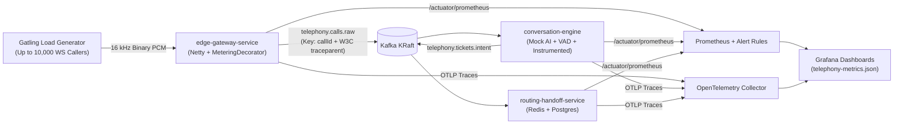
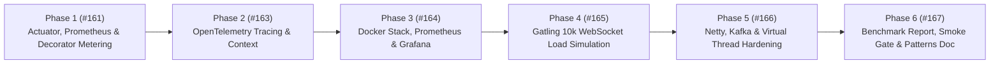

# Epic 7: 10,000 Concurrent Calls Load Testing, Observability & Performance Hardening

* **Tracking Issue:** [#159](https://github.com/pedrazamiguez/voice-pulse/issues/159)
* **Status:** **Next**

## 1. Executive Summary & Objective

Based on the architectural blueprints in **[RFC-0001](../rfcs/RFC-0001-VOICEPULSE.md)** (§3, §4.6, §6), **[RFC-0002](../rfcs/RFC-0002-VOICEPULSE.md)** (§9.3, §12, §13), **[RFC-0003](../rfcs/RFC-0003-VOICEPULSE.md)** (§2 & §5), and **[metrics-and-slos.md](../engineering/metrics-and-slos.md)**, **Epic 7** validates platform resilience and latency SLAs under severe storm-surge concurrency while closing out deferred observability and Decorator pattern scope from closed [#60](https://github.com/pedrazamiguez/voice-pulse/issues/60).

The primary objectives of Epic 7 are:
1. **Actuator, Micrometer Prometheus & Decorator Metering Baseline:** Expose `/actuator/prometheus` and `/actuator/health` across `edge-gateway-service`, `conversation-engine`, and `routing-handoff-service`; implement `MeteringAudioPublisherDecorator` wrapping `AudioFramePublisherPort` (`kafka` vs. `loopback`) without violating Hexagonal purity or breaking `GatewayDomainConfiguration` / `GatewayKafkaConfigurationTest`; reconcile `EchoLatencyTracker` and `KafkaPublisherMetricsTracker`; and instrument `ConversationDialogProcessorPort` and routing/handoff pipelines.
2. **OpenTelemetry Distributed Tracing:** Propagate W3C trace context (`traceparent`) from Netty WebSockets through Kafka record headers (`telephony.calls.raw`, `telephony.calls.control`, `telephony.tickets.intent`) into PostgreSQL and Redis spans with configurable OTLP export.
3. **Full-Stack Containerization & Observability Stack (`docker-compose.yml`, `observability/`):** Package all three Spring Boot services alongside Kafka KRaft, Redis 7, PostgreSQL 16, OpenTelemetry Collector, Prometheus (scrape targets + SLO alert rules), and Grafana (`observability/grafana/dashboards/telephony-metrics.json`).
4. **Gatling 10,000-Call Concurrent WebSocket Load Simulation (`load-generator/`):** Orchestrate up to 10,000 concurrent synthetic callers streaming 16 kHz Mono Linear PCM (20 ms / 640-byte chunks) to `/ws/calls/{callId}/audio` in `AI_MODE=mock`, alongside a fast `make load-smoke` profile.
5. **Netty Direct Memory, Kafka Partition & Virtual Thread Hardening:** Profile heap, Netty direct memory (`jvm_buffer_total_capacity_bytes{id="direct"}`), Kafka consumer lag/batching, backpressure signaling, and Java 21 Virtual Thread pinning (`-Djdk.tracePinnedThreads`) under sustained load, with zero `ByteBuf` leaks under `-Dio.netty.leakDetection.level=PARANOID`.
6. **Benchmark Evidence & As-Built Design Patterns Blueprint:** Publish `docs/benchmarks/load-test-results.md` against `metrics-and-slos.md` SLOs and author `docs/architecture/design-patterns-blueprint.md` covering all implemented patterns across Epics 1–7.

---

## 2. Observability & Load Testing Architecture

---

## 3. Implementation Phases & Tracked GitHub Sub-Issues

Each phase below is tracked as an individual sub-issue of [#159](https://github.com/pedrazamiguez/voice-pulse/issues/159) and will be planned in detail via `vp-plan-issue` prior to implementation:

### Phase 1: Actuator Prometheus Baseline, Decorator Metering & SLI Instrumentation — [#161](https://github.com/pedrazamiguez/voice-pulse/issues/161)
* **Target Modules:** `pom.xml`, `edge-gateway-service`, `conversation-engine`, `routing-handoff-service`
* **Objective:** Expose `/actuator/prometheus` and `/actuator/health` across all services, implement `MeteringAudioPublisherDecorator` (deferred from [#60](https://github.com/pedrazamiguez/voice-pulse/issues/60)), and align exported meters with `docs/engineering/metrics-and-slos.md`.
* **Deliverables:**
  - `spring-boot-starter-actuator` and `micrometer-registry-prometheus` dependencies and endpoint configuration in `application.yml`.
  - `MeteringAudioPublisherDecorator` in `edge-gateway-service` `infrastructure` wrapping `AudioFramePublisherPort` (`kafka` vs. `loopback`) while preserving `GatewayDomainConfiguration` (`@ConditionalOnMissingBean` / `BeanPostProcessor` or explicit qualifier/`@Primary`) so `GatewayKafkaConfigurationTest` and `CallSessionService` continue to wire cleanly.
  - Reconcile `EchoLatencyTracker` and `KafkaPublisherMetricsTracker` with Micrometer meters to eliminate duplicate metric state.
  - Instrument `ConversationDialogProcessorPort` (`MockLlmConversationProcessor` / `LiveLlmConversationProcessor`) and `routing-handoff-service` dispatch pipelines for `voicepulse_llm_inference_seconds`, `voicepulse_ttfa_seconds`, `voicepulse_bargein_purge_seconds`, `voicepulse_bargein_events_total`, `voicepulse_active_operators`, Netty direct memory, and Kafka consumer lag.
  - Unit and Spring `ApplicationContextRunner` tests verifying decorator delegation and meter registration.

### Phase 2: OpenTelemetry Distributed Tracing & Context Propagation — [#163](https://github.com/pedrazamiguez/voice-pulse/issues/163)
* **Target Modules:** `shared-kernel`, `edge-gateway-service`, `conversation-engine`, `routing-handoff-service`
* **Objective:** Propagate W3C trace context (`traceparent`) across Netty WebSockets, Kafka topics, Redis, and PostgreSQL without blocking event-loop threads.
* **Deliverables:**
  - `micrometer-tracing-bridge-otel`, `opentelemetry-exporter-otlp`, and Reactor context propagation configuration.
  - WebSocket -> Kafka producer header injection and Kafka consumer -> `PinnedAudioWorkerPool` / Virtual Thread trace continuation.
  - Configurable OTLP endpoint and sampling settings in `application.yml` (`${OTEL_EXPORTER_OTLP_ENDPOINT:...}`).
  - Unit and integration tests verifying trace ID continuity end-to-end under `-Dio.netty.leakDetection.level=PARANOID`.

### Phase 3: Full-Stack Containerization & Observability Dashboards — [#164](https://github.com/pedrazamiguez/voice-pulse/issues/164)
* **Target Modules:** Root `docker-compose.yml`, service Dockerfiles, `observability/`, `Makefile`
* **Objective:** Containerize all VoicePulse microservices alongside Prometheus, Grafana, and OpenTelemetry Collector.
* **Deliverables:**
  - Multi-stage Java 21 Dockerfiles for `edge-gateway-service`, `conversation-engine`, and `routing-handoff-service`.
  - `observability/otel-collector.yml`, `observability/prometheus/prometheus.yml` (with alert rules from `docs/engineering/metrics-and-slos.md`), and `observability/grafana/dashboards/telephony-metrics.json`.
  - Root `docker-compose.yml` and `Makefile` targets for spinning up and verifying the full observability stack.

### Phase 4: Gatling 10,000-Call Concurrent WebSocket Load Simulation — [#165](https://github.com/pedrazamiguez/voice-pulse/issues/165)
* **Target Module:** `load-generator/`
* **Objective:** Build the Tier-4 Gatling simulation orchestrating up to 10,000 concurrent synthetic WebSocket callers streaming 16 kHz Mono Linear PCM.
* **Deliverables:**
  - Gatling Java 21 load simulation sending 20 ms (640-byte) PCM binary frames to `/ws/calls/{callId}/audio` against `AI_MODE=mock`.
  - Configurable ramp profiles (local smoke profile vs. 10,000-call storm surge) with Gatling SLA assertions on connection success, frame drop rate, and latency budgets.
  - `Makefile` targets for reproducible load runs.

### Phase 5: Netty Direct Memory, Kafka Partition & Virtual Thread Hardening — [#166](https://github.com/pedrazamiguez/voice-pulse/issues/166)
* **Target Modules:** `edge-gateway-service`, `conversation-engine`, `routing-handoff-service`
* **Objective:** Execute sustained high-concurrency runs and eliminate memory, backpressure, consumer lag, or Virtual Thread pinning bottlenecks.
* **Deliverables:**
  - Netty direct memory (`jvm_buffer_total_capacity_bytes{id="direct"}`) and `PooledByteBufAllocator` profiling with zero `ByteBuf` leaks under `PARANOID` soak tests.
  - Kafka producer batching, partition scaling, `PinnedAudioWorkerPool` tuning, and `BackpressureSignal` calibration.
  - Virtual Thread pinning audit (`-Djdk.tracePinnedThreads=full`) across PostgreSQL JDBC, Redis, and MCP client adapters.

### Phase 6: Benchmark Report, CI Load Smoke Gate & As-Built Design Patterns Blueprint — [#167](https://github.com/pedrazamiguez/voice-pulse/issues/167)
* **Target Locations:** `docs/benchmarks/load-test-results.md`, `docs/architecture/design-patterns-blueprint.md`, `Makefile`
* **Objective:** Publish reproducible load benchmark evidence, wire a fast smoke verification target, and document the as-built design patterns across Epics 1–7.
* **Deliverables:**
  - `docs/benchmarks/load-test-results.md` comparing measured p50/p95/p99 latency, throughput, direct memory, and consumer lag against `docs/engineering/metrics-and-slos.md`.
  - `make load-smoke` target verifying Prometheus scraping and short Gatling WebSocket smoke execution.
  - `docs/architecture/design-patterns-blueprint.md` (deferred from [#60](https://github.com/pedrazamiguez/voice-pulse/issues/60)) cataloging Strategy, Sealed State FSMs, Decorator, Factory/Assembler, Null Object, and Adapter/MapStruct patterns.

---

## 4. Architectural Invariants & Guardrails

1. **Domain Core Purity:** Zero imports of Spring, Netty, Micrometer, OpenTelemetry, Kafka, Redis, Jackson, Lombok, MapStruct, or JDBC in `..domain..` packages.
2. **Memory Safety:** Every Netty `ByteBuf` remains deterministically released (`ReferenceCountUtil.release()` / `DataBufferUtils.release()`) with zero direct memory leaks under `-Dio.netty.leakDetection.level=PARANOID`.
3. **Non-Blocking Observability:** Metrics timers, counters, and trace propagation MUST NEVER block Netty event-loop threads.
4. **Top-Level Classes & File Ceiling:** Zero nested production classes (except `record` permits inside `sealed interface`), zero inline FQNs, zero files over 600 lines, `@RequiredArgsConstructor` + `@Slf4j` in infrastructure/application, and fail-fast `@ConfigurationProperties` without `@DefaultValue` or constant defaults.
5. **Formatting & Verification Gate:** All changes formatted with Google Java Format (`./mvnw spotless:check`) and verified with `make pre-pr`.
