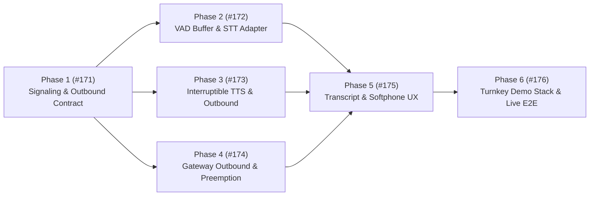

# Epic 8: Live Voice Pipeline (STT/TTS), Bot Audio Return & End-to-End Demo Stack

* **Tracking Issue:** [#170](https://github.com/pedrazamiguez/voice-pulse/issues/170)
* **Status:** **Planned**

## 1. Executive Summary & Objective

Based on the architectural blueprints in **[RFC-0001](../rfcs/RFC-0001-VOICEPULSE.md)** (§4.3 & §4.4) and **[RFC-0003](../rfcs/RFC-0003-VOICEPULSE.md)** (§3 & §4), **Epic 8** closes the end-to-end live voice loop across `shared-kernel`, `edge-gateway-service`, `conversation-engine`, and `scripts/mcp`, delivering a true zero-CLI browser demo experience.

The primary objectives of Epic 8 are:
1. **Call Lifecycle Signaling & Outbound Audio Contract:** Emit `CallStarted` and `CallTerminated` events on `telephony.calls.control` from `edge-gateway-service` on caller WebSocket connect/disconnect, add `OutboundAudioChunkEnvelope` + the `telephony.calls.outbound` topic, and define pure domain `SpeechToTextPort`, `TextToSpeechPort`, and `OutboundAudioPublisherPort` contracts.
2. **VAD Speech Buffering & Virtual-Thread STT Adapter:** Buffer active-speech 16 kHz Mono Linear PCM frames per `callId` inside `conversation-engine` and transcribe utterances on `TrailingSilenceEvaluator` turn boundaries over Java 21 Virtual Threads into `ProgressConversationUseCase.progressTurn(...)`.
3. **Interruptible TTS Synthesis & Outbound Kafka PCM Streaming:** Synthesize `DialogTurnResult.responseText()` into 20 ms (640-byte) 16 kHz Mono PCM frames published to `telephony.calls.outbound` (strictly keyed by `callId.toString()`), aborting in-flight synthesis immediately upon `BargeInDetected`.
4. **Gateway Outbound Audio Consumer & Human Bridge Preemption:** Consume `telephony.calls.outbound` in `edge-gateway-service` and stream binary PCM frames to `ConcurrentSessionRegistry` with zero `ByteBuf` leaks under `-Dio.netty.leakDetection.level=PARANOID`, dropping queued frames on `BargeInInterrupt` and preempting bot playback cleanly when `OperatorRerouteSignal` connects the human operator bridge.
5. **Live Transcript Propagation & Softphone Turn UX:** Capture `BOT` and `CALLER` spoken turns in `ConversationSession` and populate `TicketFormFilledEvent.payload()` (`"transcript"` key consumed by `TranscriptContextExtractor`), while surfacing non-intrusive status and caption telemetry on the Caller Softphone UI.
6. **Turnkey Local Demo Stack (`make demo`) & Live Voice E2E Test:** Package Kafka KRaft, Redis 7, PostgreSQL 16, all 3 Python MCP servers (`scripts/mcp/`), local OpenAI-compatible STT/TTS/LLM containers, and all 3 Spring Boot services into `docker-compose.demo.yml` + `make demo`, validated by `EndToEndLiveVoicePipelineIntegrationTest` and `docs/engineering/live-demo-guide.md`.

---

## 2. End-to-End Live Voice Pipeline Architecture

```mermaid
sequenceDiagram
    autonumber
    participant Caller as Caller Softphone (:8080)
    participant GW as edge-gateway-service
    participant Kafka as Kafka KRaft
    participant Engine as conversation-engine
    participant STT_TTS as STT / TTS / LLM + MCP
    participant Routing as routing-handoff-service
    participant Console as Operator Console (:8082)

    Caller->>GW: Connect WS /ws/calls/{callId}/audio
    GW->>Kafka: CallStarted (telephony.calls.control, key=callId)
    Kafka->>Engine: Start conversation + AI greeting
    Engine->>STT_TTS: TextToSpeechPort (greeting PCM)
    Engine->>Kafka: OutboundAudioChunkEnvelope (telephony.calls.outbound, key=callId)
    Kafka->>GW: Stream 20ms binary PCM frames
    GW->>Caller: Binary WebSocket audio playback

    Caller->>GW: Speak into microphone (16 kHz PCM)
    GW->>Kafka: Raw PCM chunks (telephony.calls.raw, key=callId)
    Kafka->>Engine: VAD active speech -> TrailingSilenceEvaluator boundary
    Engine->>STT_TTS: SpeechToTextPort (Virtual Thread) -> user utterance
    Engine->>STT_TTS: LiveLlm + MCP (CRM, Flight, Ticket) -> <=25 word reply
    Engine->>Kafka: Bot TTS PCM (telephony.calls.outbound)

    Note over Caller,Engine: Barge-in speech cancels in-flight TTS & flushes outbound gateway buffer

    Engine->>Kafka: TicketFormFilledEvent (+ spoken transcript)
    Kafka->>Routing: Persist Postgres + match AVAILABLE operator in Redis
    Routing->>Console: Push Ticket + Transcript + Queue Signal
    Routing->>Kafka: OperatorRerouteSignal (telephony.calls.control)
    Kafka->>GW: Preempt bot playback & attach operator audio bridge
    Caller<-->Console: Live two-way PCM conversation
```

---

## 3. Implementation Phases & Tracked GitHub Sub-Issues

Each phase below is tracked as an individual sub-issue of [#170](https://github.com/pedrazamiguez/voice-pulse/issues/170) and will be planned in detail via `vp-plan-issue` prior to implementation:



### Phase 1: Lifecycle Signaling, `OutboundAudioChunkEnvelope`, Domain Ports & Topic Config — [#171](https://github.com/pedrazamiguez/voice-pulse/issues/171)
* **Target Modules:** `shared-kernel`, `edge-gateway-service`, `conversation-engine`, `scripts/verify-infra.sh`, `Makefile`
* **Objective:** Establish the event contracts, Kafka topic provisioning, and lifecycle triggers connecting caller WebSocket sessions to `conversation-engine` and outbound bot audio.
* **Deliverables:**
  - `OutboundAudioChunkEnvelope` record in `shared-kernel` (`callId`, `turnId`, `sequenceNumber`, `pcmBytes`, `endOfTurn`, `emittedAt`).
  - `telephony.calls.outbound` topic configuration across Spring Kafka configs, `scripts/verify-infra.sh`, and `Makefile`.
  - Pure domain interfaces in `conversation-engine`: `SpeechToTextPort`, `TextToSpeechPort`, and `OutboundAudioPublisherPort`.
  - `edge-gateway-service` emission of `CallStarted` / `CallTerminated` on `telephony.calls.control` (strictly keyed by `callId.toString()`) and `conversation-engine` lifecycle handling (`startConversation(...)` + `terminateConversation(...)`).

### Phase 2: VAD Speech Frame Buffering, `SpeechToTextPort` Adapter & Automated Turn Trigger — [#172](https://github.com/pedrazamiguez/voice-pulse/issues/172)
* **Target Module:** `conversation-engine`
* **Objective:** Accumulate per-call active speech frames and automatically transcribe utterances into conversational turns without blocking Kafka/Netty worker threads.
* **Deliverables:**
  - Bounded per-call `UtteranceAudioBuffer` accumulating 16 kHz Mono 16-bit PCM frames during active speech, resetting on `BargeInDetected` / `CallTerminated`, and enforcing max utterance length caps.
  - `SpeechToTextPort` strategy adapters: `OpenAiCompatibleSttAdapter` (calling configurable `/v1/audio/transcriptions` over Java 21 Virtual Threads with PCM-to-WAV framing) and `MockSttAdapter` (`voicepulse.conversation.stt.mode=mock`).
  - Orchestration wiring triggering transcription on `TrailingSilenceEvaluator` end-of-speech into `ProgressConversationUseCase.progressTurn(...)`.
  - Unit and WireMock integration tests covering active-speech buffering, noise suppression (`rms < threshold`), blank transcripts, and bounded buffer eviction.

### Phase 3: Interruptible `TextToSpeechPort`, 20 ms PCM Chunker & Outbound Kafka Streaming — [#173](https://github.com/pedrazamiguez/voice-pulse/issues/173)
* **Target Module:** `conversation-engine`
* **Objective:** Convert AI greeting and turn responses into smooth 20 ms 16 kHz Mono PCM chunks streamed to `telephony.calls.outbound` with instantaneous barge-in cancellation.
* **Deliverables:**
  - `TextToSpeechPort` strategy adapters: `OpenAiCompatibleTtsAdapter` (`/v1/audio/speech` requesting 16 kHz Mono PCM / WAV header stripping over Java 21 Virtual Threads) and `MockTtsAdapter` (deterministic PCM tone/sine synthesis).
  - `PcmFrameChunker` slicing synthesized audio into fixed 640-byte (20 ms) frames and publishing `OutboundAudioChunkEnvelope` keyed by `callId.toString()`.
  - Atomic turn/playback epoch cancellation stopping in-flight TTS synthesis and outbound chunk emission immediately on `BargeInDetected` or `CallTerminated`.
  - Unit and integration tests verifying chunk boundaries, ordering, and immediate cancellation latency.

### Phase 4: Gateway `telephony.calls.outbound` Consumer, WebSocket Sink & Human Bridge Preemption — [#174](https://github.com/pedrazamiguez/voice-pulse/issues/174)
* **Target Module:** `edge-gateway-service`
* **Objective:** Deliver outbound bot PCM chunks reliably to the Caller Softphone WebSocket with strict Netty memory safety and seamless cutover to the live human operator bridge.
* **Deliverables:**
  - `telephony.calls.outbound` Kafka consumer forwarding PCM frames to `ConcurrentSessionRegistry` without blocking Netty event loops.
  - Explicit `ReferenceCountUtil.release()` / `DataBufferUtils.release()` lifecycle management validated under `-Dio.netty.leakDetection.level=PARANOID`.
  - `BargeInInterrupt` outbound buffer flush + `OperatorRerouteSignal` bot-playback preemption so human operator voice takes over cleanly on bridge connect.
  - Unit and integration tests covering barge-in flush, bridge preemption, and zero leaked buffers on sudden disconnect.

### Phase 5: Live Transcript Propagation to `TicketFormFilledEvent` & Softphone Turn UX — [#175](https://github.com/pedrazamiguez/voice-pulse/issues/175)
* **Target Modules:** `conversation-engine`, `edge-gateway-service`
* **Objective:** Ensure the human operator inherits the full live spoken conversation context upon handoff and improve Softphone observability during live demos.
* **Deliverables:**
  - Immutable `TranscriptTurn` (`BOT` / `CALLER`, text, timestamp) recording inside `ConversationSession` and serialization into `TicketFormFilledEvent.payload()` (`"transcript"` key consumed by `routing-handoff-service` `TranscriptContextExtractor`).
  - Lightweight WebSocket text control frames (`CALL_STATE`, `BOT_TRANSCRIPT`, `USER_TRANSCRIPT`, `HANDOFF_CONNECTED`) rendered cleanly as live captions/status on `edge-gateway-service`'s Softphone (`softphone/index.html`).
  - End-to-end verification that tickets received in `routing-handoff-service` include the spoken transcript in the Operator Web Console.

### Phase 6: Turnkey Local Voice Demo Stack (`make demo`), Live E2E Suite & Demo Guide — [#176](https://github.com/pedrazamiguez/voice-pulse/issues/176)
* **Target Modules:** Root `docker-compose.demo.yml`, `Makefile`, `scripts/mcp/`, `conversation-engine`, `routing-handoff-service`, `docs/engineering/`
* **Objective:** Enable a single-command browser demo of the complete SkyWay Airlines disruption call flow from AI greeting through operator voice handoff.
* **Deliverables:**
  - `docker-compose.demo.yml` + `make demo` / `make demo-down` starting Kafka KRaft, Redis 7, Postgres 16, all 3 Python FastMCP servers (`mcp-crm-server`, `mcp-ticket-server`, `mcp-telephony-routing`), local OpenAI-compatible STT/TTS/LLM containers (with documented mock/local/cloud profiles), and all 3 Spring Boot services.
  - Multi-module `EndToEndLiveVoicePipelineIntegrationTest` exercising caller PCM connect -> `CallStarted` -> greeting TTS -> spoken caller PCM -> STT -> LLM + MCP ticket synthesis -> `TicketFormFilledEvent` (+ transcript) -> Postgres persistence -> Redis operator assignment -> `OperatorRerouteSignal` -> operator audio bridge.
  - Step-by-step operator/presenter runbook at `docs/engineering/live-demo-guide.md`.

---

## 4. Architectural Invariants & Guardrails
* **Hexagonal Domain Purity:** `SpeechToTextPort`, `TextToSpeechPort`, `OutboundAudioPublisherPort`, `UtteranceAudioBuffer`, and `TranscriptTurn` must contain zero Spring, Netty, Kafka, Jackson, Lombok, or MapStruct imports.
* **Memory Safety (`PARANOID`):** Every Netty `ByteBuf` / WebFlux `DataBuffer` created or retained for outbound bot audio or operator bridge frames must be deterministically released on send completion, cancellation, or error.
* **Non-Blocking Netty Event Loops:** HTTP calls to STT, TTS, and LLM/MCP endpoints run exclusively on Java 21 Virtual Threads (`Executors.newVirtualThreadPerTaskExecutor()`).
* **Kafka Partition Key Mandate:** `telephony.calls.raw`, `telephony.calls.control`, `telephony.calls.outbound`, and `telephony.tickets.intent` strictly use `callId.toString()` as the partition key.
* **AGENTS.md Standards:** Top-level classes only (except `record` permits inside `sealed interface`), zero inline FQNs, <= 600 lines per Java file, `@RequiredArgsConstructor` + `@Slf4j`, fail-fast `@ConfigurationProperties` validation, and clean `make pre-pr` verification.
