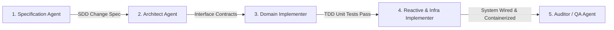

# VoicePulse: AI Engineering, Tooling & Automation Blueprint
## Transposing SplitTrip's Agentic Ecosystem to a High-Throughput Java 21 / Spring Boot Voice Platform

---

## 1. Executive Strategy: The SplitTrip Paradigm Adapted to Java

SplitTrip achieves extraordinary development velocity, token efficiency, and architectural consistency by treating **AI not as an ad-hoc autocomplete chatbot, but as a structured, deterministic compiler of specifications and code**.

This engineering blueprint translates the proven multi-agent architecture, local Model Context Protocol (MCP) toolchains, zero-cloud-cost documentation RAG, automated architecture testing, and phased GitHub workflows from SplitTrip into **VoicePulse**—a distributed, reactive Java 21 / Spring Boot 3 WebFlux telephony triage engine.

```
+---------------------------------------------------------------------------------------------------------+
|                                    SPLITTRIP PATTERN -> VOICEPULSE TRANSLATION                          |
+------------------------------------+------------------------------------+-------------------------------+
| Dimension                          | SplitTrip (Mobile Reference)       | VoicePulse (Java Platform)    |
+------------------------------------+------------------------------------+-------------------------------+
| Language & Concurrency             | Kotlin 2.x + Coroutines/Flow       | Java 21 + Netty WebFlux + VTs |
| Architectural Style                | Clean Architecture + MVI           | Hexagonal (Ports & Adapters)  |
| State Discipline                   | Immutable UiState + Events         | Finite State Machine + Events |
| Architectural Testing              | Konsist (Kotlin AST rules)         | ArchUnit (Java Bytecode rules)|
| Formatting & Linting               | Ktlint + Detekt + CPD              | Spotless + Error Prone + CPD  |
| Coverage Enforcement               | JaCoCo Module & Merged Gates       | JaCoCo Multi-Module Gates     |
| Code Intelligence Graph            | codebase-memory-mcp + Graphify     | codebase-memory-mcp + Graphify|
| In-Repo Architectural RAG          | splittrip-rag (fastembed + SQLite) | voicepulse-rag (CPU ONNX)     |
| Continuous Integration             | GitHub Actions Multi-Job Pipeline  | GitHub Actions CI + Matrix    |
| Developer Ergonomics               | Unified Makefile + Pre-commit      | Unified Makefile + Pre-commit |
+------------------------------------+------------------------------------+-------------------------------+
```

### The Dual AI Architecture of VoicePulse

A critical distinction when building VoicePulse is that it operates with **two distinct AI layers**:

1. **AI in Development (The Meta-System):** The local agentic ecosystem (MCP tools, skills, rules, RAG, and CI gates) that helps you specify, write, test, and refactor VoicePulse with 80–99% token savings.
2. **AI in Production (The Runtime System):** The runtime conversational triage agent inside VoicePulse that performs real-time STT, state transitions, MCP tool execution (`mcp-crm-server`, `mcp-ticket-server`, `mcp-telephony-routing`), and TTS audio synthesis.

This document provides the end-to-end guide to build, configure, and automate the **Development System** while scaffolding the runtime contracts for the **Production System**.

---

## 2. Directory Layout & Configuration Hierarchy

To match SplitTrip's clean separation of passive constraints, active agent skills, living documentation, and operational scripts, VoicePulse organizes its repository as follows:

```
voicepulse/
├── .agents/
│   ├── rules/                         # Passive, always-on agent guardrails
│   │   ├── 01-hexagonal-architecture.md
│   │   ├── 02-java21-concurrency.md
│   │   ├── 03-netty-bytebuf-safety.md
│   │   └── 04-kafka-partitioning.md
│   └── skills/                        # Active, executable agent workflows
│       ├── vp-create-issue/SKILL.md   # Idea & screenshot ingestion to GitHub issue
│       ├── vp-plan-issue/SKILL.md     # Feature specification & interface contracts
│       ├── vp-start-issue/SKILL.md    # Phased TDD implementation & file guards
│       ├── vp-replan-issue/SKILL.md   # Architectural realignment
│       ├── vp-verify-architecture/SKILL.md # ArchUnit + Spotless + SpotBugs checks
│       ├── vp-address-sonar-issues/SKILL.md# Quality gate & vulnerability remediation
│       ├── vp-address-pr-comments/SKILL.md # Review feedback resolution
│       └── vp-follow-up/SKILL.md      # In-flight scope amendments & post-merge follow-ups
├── .github/
│   ├── workflows/
│   │   ├── build-and-test.yml         # Unit + Testcontainers integration tests
│   │   ├── static-analysis.yml        # Spotless, Error Prone, SpotBugs, CPD, Checkstyle
│   │   ├── coverage-and-architecture.yml # JaCoCo gates + ArchUnit tests
│   │   ├── codeql.yml                 # Semantic AST security scanning
│   │   ├── create-branch-from-issue.yml # Automatic git branch creation
│   │   └── enforce-branch-naming.yml  # Branch pattern validation
│   └── pull_request_template.md
├── .opencode/
│   ├── opencode.json                  # OpenCode tool and plugin registry
│   └── plugins/graphify.js
├── config/
│   ├── archunit/                      # ArchUnit custom rule definitions
│   ├── checkstyle/checkstyle.xml      # Style constraints
│   ├── error-prone/                   # Compiler analysis flags
│   ├── spotbugs/exclude.xml           # SpotBugs bug filters
│   └── spotless/google-java-format.xml# Code formatting definition
├── docs/                              # Living domain & architecture knowledge base
│   ├── domain/                        # Telephony invariants, state diagrams, ticket schemas
│   ├── architecture/                  # C4 diagrams, Kafka partitioning, Netty reactive loops
│   ├── engineering/                   # Quality gates, testing pyramid, metrics SLOs
│   └── ai/                            # Multi-agent taxonomy, MCP catalog, token economics
├── scripts/
│   ├── ai-setup.sh                    # Idempotent toolchain bootstrapper
│   ├── rag_indexer.py                 # FastEmbed CPU ONNX documentation indexer
│   ├── rag_mcp_server.py              # Stdio MCP server for local documentation RAG
│   ├── test_rag.py                    # RAG verification test suite
│   └── pre-commit                     # Blazing fast local Git hook
├── AGENTS.md                          # Single source of truth for AI instructions
├── Makefile                           # Unified developer and CI entry point
├── pom.xml / build.gradle.kts         # Root build descriptor (multi-module)
└── [service modules: edge-gateway, conversation-engine, routing-service, etc.]
```

---

## 3. Passive Agent Directives: `AGENTS.md` Specification

`AGENTS.md` at the project root is the foundational instruction set ingested by every AI agent before writing any code. It sets strict boundaries to prevent architectural regressions, memory leaks, and scope creep.

```markdown
# AGENTS.md — VoicePulse Engineering Directives

> [!IMPORTANT]
> **Source of Truth:** This file defines the inviolable architectural constraints, coding standards, and agent operational boundaries for VoicePulse.

## 1. Architectural Style: Strict Hexagonal Architecture (Ports & Adapters)

- **Domain Core Purity:** The `domain` package within any service MUST NOT import any framework annotations or libraries:
  - ❌ Forbidden: `org.springframework.*`, `io.netty.*`, `org.apache.kafka.*`, `jakarta.persistence.*`.
  - ✅ Permitted: Standard Java 21 (`java.time.*`, `java.util.*`), pure domain records, and domain port interfaces.
- **Port Interfaces:** Driving ports (Inbound) and Driven ports (Outbound) must be declared in `domain.ports`.
- **Adapters:** Infrastructure adapters (`infrastructure.kafka`, `infrastructure.ws`, `infrastructure.persistence`) depend on Domain, NEVER the reverse.

## 2. Java 21 & Concurrency Rules

- **Records for Data:** All immutable event models, value objects, and DTOs MUST be declared as `record`.
- **Sealed Interfaces for State Machines:** Call session states and domain events MUST use `sealed interface` with exhaustive pattern matching:
  ```java
  public sealed interface CallState permits Connected, CollectingData, Confirming, HandoffReady, Terminated {}
  ```
- **ByteBuf Allocation & Memory Safety:**
  - When handling raw audio frames in Netty WebFlux, every received `ByteBuf` MUST be explicitly released via `ReferenceCountUtil.release(byteBuf)` or retained if forwarded down the pipeline.
  - Zero tolerance for Direct Memory leaks. Netty leak detection must pass at `PARANOID` level in integration tests.
- **Virtual Threads vs. Event Loop:**
  - Edge Gateway uses Netty event-loop non-blocking I/O. NEVER block Netty worker threads with synchronous calls or file I/O.
  - Heavy blocking operations (e.g. legacy database queries, external REST) must be offloaded to Virtual Thread executors (`Executors.newVirtualThreadPerTaskExecutor()`).

## 3. Kafka Partitioning & Event Ordering

- **Partition Key Mandate:** Every event produced to `telephony.calls.raw` and `telephony.calls.control` MUST use `callId.toString()` as the partition key.
- **Strict In-Order Consumption:** Never process raw audio frames or state transitions asynchronously across separate uncoordinated threads for the same `callId`.

## 4. Code Quality & Formatting

- **File Size Limit:** Production source files MUST NOT exceed 600 lines. Break large handlers into composite pipeline steps before hitting this limit.
- **No Wildcard Imports:** NEVER use `import java.util.*;`. Explicit imports only.
- **No System.out:** ALWAYS use SLF4J structured logging: `log.info("Processing call packet", kv("callId", callId), kv("seq", seq));`.
```

---

## 4. Multi-Agent Taxonomy & Phased SDD Lifecycle

SplitTrip replaces monolithic, error-prone prompts with a **5-stage Specification-Driven Development (SDD)** pipeline. Each persona has a tightly scoped responsibility, specific MCP tools, and deterministic entry/exit criteria:



### The 5 Agent Personas for VoicePulse

#### 1. Specification Agent
* **Mission:** Ingests customer support business requirements, voice triage briefs, or GitHub issues. Consults `/docs/domain/` to verify ticket field constraints, telephony latency limits, and barge-in semantics.
* **Grounding Sources:** `/docs/domain/*.md`, GitHub issue description.
* **MCP Tools:** `github-mcp-server` (`issue_read`), `voicepulse-rag` (`search_project_knowledge`).
* **Output Artifact:** Formal SDD Specification containing user dialog trees, ticket schema invariants, state transition matrices, and latency budgets ($\le 300\text{ms}$ time-to-first-audio).
* **Boundary:** Does not write Java code or design database schemas.

#### 2. Architect Agent
* **Mission:** Validates hexagonal boundaries, specifies Inbound/Outbound Port signatures, defines Kafka message schemas (Avro/JSON), and determines Netty buffer strategies.
* **Grounding Sources:** `/docs/architecture/*.md`, `docs/architecture/c4-container.png`.
* **MCP Tools:** `codebase-memory-mcp` (`search_graph`, `trace_path`), `graphify` (`query_graph`).
* **Output Artifact:** Architecture Contract specifying exact file paths (`[NEW]`, `[MODIFY]`), Java interface signatures, Kafka partition keys, and package boundaries.
* **Boundary:** Guarantees zero infrastructure dependencies in domain modules.

#### 3. Domain Implementer
* **Mission:** Implements pure business logic, call session Finite State Machines, VAD threshold calculations, ticket validation, and unit tests using strict TDD.
* **Grounding Sources:** Architecture Contract, `/docs/domain/ticket-schema.md`.
* **Tools:** Java 21 compiler, JUnit 5, AssertJ, Mockito.
* **Output:** Pure Java records, sealed state interfaces, domain services, and comprehensive unit tests.
* **Boundary:** Zero imports from Spring, Netty, Kafka, or Jackson in domain code.

#### 4. Reactive & Infra Implementer
* **Mission:** Implements Netty WebSocket handlers, Kafka reactive consumers/producers, Redis presence stores, and PostgreSQL JSONB repositories.
* **Grounding Sources:** `/docs/architecture/kafka-topology.md`, Netty ByteBuf guidelines.
* **MCP Tools:** `postgres-mcp`, `kafka-mcp`, `voicepulse-rag`.
* **Output:** WebFlux handlers, Kafka partition listeners, Testcontainers integration tests, and Docker Compose services.
* **Boundary:** Must ensure all `ByteBuf` references are safely released and Kafka partition keys match `callId`.

#### 5. Auditor / QA Agent
* **Mission:** Runs static analysis, ArchUnit rules, SpotBugs, CPD, JaCoCo coverage gates, and verifies that the 600-line limit is observed.
* **Grounding Sources:** `/docs/engineering/quality-gates.md`, `config/archunit/`.
* **MCP Tools:** `sonarqube-mcp`.
* **Verification Gates:**
  - `./gradlew test` or `mvn test` (JUnit 5 + ArchUnit).
  - Spotless formatting check (`make check-format`).
  - SpotBugs + Error Prone compile audit.
  - Zero files over 600 lines.
* **Boundary:** Fails the PR pipeline if any rule or coverage threshold is violated.

---

## 5. Active Agent Skills (`.agents/skills/`)

Skills are active markdown workflows with YAML frontmatter that orchestrate the development lifecycle.

### Skill 0: `vp-create-issue` (`.agents/skills/vp-create-issue/SKILL.md`)

```markdown
---
name: vp-create-issue
description: Convert an idea, plain English description, or screenshots into a structured VoicePulse GitHub issue with human approval.
mode: agent
tools:
  - codebase
  - githubRepo
  - terminalLastCommand
arguments:
  - name: input
    description: Raw idea, plain English problem description, or path to screenshot/log image.
    required: false
---
# Create Issue

1. **Input Ingestion & Analysis:** Ingest plain text ideas, bug descriptions, stack traces, or inspect screenshot image paths.
2. **Context Discovery:** Scan recent issues (`gh issue list`) to determine sequential `[VP-XX]` prefix, map affected modules, and reference relevant RFCs.
3. **Label & Epic Resolution:** Assign mandatory type (`bug`, `enhancement`, `documentation`), domain labels, and associate with active epic (`epic-1`, etc.).
4. **Draft Generation:** Generate structured issue with Context, Scope, Acceptance Criteria, and Architectural Invariants.
5. **Human Approval Gate (Mandatory):** Present the complete draft to the developer and await explicit confirmation.
6. **Creation & Handoff:** Run `gh issue create` upon approval and direct user to `vp-plan-issue`.
```

### Skill 1: `vp-plan-issue` (`.agents/skills/vp-plan-issue/SKILL.md`)

```markdown
---
name: vp-plan-issue
description: Plan a VoicePulse GitHub issue by creating a detailed Hexagonal architectural specification.
mode: agent
tools:
  - codebase
  - githubRepo
arguments:
  - name: issue_number
    description: The GitHub issue number to plan.
    required: true
---
# Plan Issue #$ISSUE_NUMBER

1. **Context Ingestion:**
   - Fetch issue #$ISSUE_NUMBER and its comment thread via `github-mcp-server`.
   - Query `voicepulse-rag` for relevant domain models (`search_project_knowledge`).

2. **Architectural Analysis:**
   - Use `codebase-memory-mcp` (`search_graph`) to locate existing ports, state machines, and handlers.
   - Verify Kafka topic contracts and partitioning requirements.

3. **Produce Implementation Plan:**
   - Define exact file changes:
     - `[NEW] src/main/java/.../domain/model/CallSession.java`
     - `[NEW] src/main/java/.../domain/ports/inbound/ProcessAudioChunkUseCase.java`
     - `[NEW] src/main/java/.../infrastructure/ws/AudioWebSocketHandler.java`
   - Specify JUnit 5 and ArchUnit test cases.
   - Specify memory management validation (ByteBuf release verification).

4. **Approval Gate:**
   - Present the plan to the developer. Post the approved plan as a comment on the GitHub issue.
```

### Skill 2: `vp-start-issue` (`.agents/skills/vp-start-issue/SKILL.md`)

```markdown
---
name: vp-start-issue
description: Implement a planned issue by strictly following the posted GitHub implementation plan.
mode: agent
tools:
  - codebase
  - githubRepo
  - terminalLastCommand
arguments:
  - name: issue_number
    description: The GitHub issue number to implement.
    required: true
---
# Start Issue #$ISSUE_NUMBER

1. **Branch & Base Verification:**
   - Verify local branch matches `feature/VP-$ISSUE_NUMBER` or `bugfix/VP-$ISSUE_NUMBER`.
   - Ensure branch is synced with `develop`: `git pull origin develop`.

2. **Retrieve Authoritative Plan:**
   - Fetch comments from issue #$ISSUE_NUMBER via `github-mcp-server`.
   - If no approved plan exists, **STOP IMMEDIATELY** and instruct developer to run `vp-plan-issue`.

3. **Pre-Implementation File Size Check:**
   - Before modifying any file, check line count: `wc -l <file>`. If $>500$ lines, extract helper classes first.

4. **TDD Implementation:**
   - Step 1: Write Domain records, sealed state interfaces, and pure unit tests. Run `mvn test -Dtest=*DomainTest`.
   - Step 2: Implement Outbound / Inbound Ports.
   - Step 3: Implement Infrastructure Adapters (WebFlux WebSocket, Kafka listeners).
   - Step 4: Write Testcontainers integration tests verifying Kafka partitioning and Netty ByteBuf lifecycle.

5. **Local Quality Verification:**
   - Run `make fast-check` (Spotless, ArchUnit, compile with Error Prone).
   - Verify `wc -l` on all touched files does not exceed 600 lines.
```

### Skill 3: `vp-verify-architecture` (`.agents/skills/vp-verify-architecture/SKILL.md`)

```markdown
---
name: vp-verify-architecture
description: Run ArchUnit tests, 600-line file checks, Spotless, and SpotBugs audits.
mode: agent
tools:
  - codebase
  - terminalLastCommand
arguments: []
---
# Verify Architecture

1. **Execute ArchUnit Test Suite:**
   ```bash
   mvn test -Dtest=ArchitectureTest
   # or with Gradle:
   ./gradlew test --tests "*ArchitectureTest"
   ```

2. **Enforce 600-Line File Limit:**
   ```bash
   find . -type f -name "*.java" ! -path "*/test/*" ! -path "*/target/*" ! -path "*/build/*" -exec wc -l {} + | awk '$1 > 600 {print $0}'
   ```
   *Any output indicates an immediate violation.*

3. **Run Static Analysis & Formatting:**
   ```bash
   make fast-check
   ```
```

### Skill 4: `vp-replan-issue` (`.agents/skills/vp-replan-issue/SKILL.md`)

```markdown
---
name: vp-replan-issue
description: Replan an issue when scope changes, unexpected architectural blockers arise, or tests fail repeatedly.
mode: agent
tools:
  - codebase
  - githubRepo
arguments:
  - name: issue_number
    description: The GitHub issue number to replan.
    required: true
  - name: reason
    description: Explanation of why replanning is required.
    required: true
---
# Replan Issue #$ISSUE_NUMBER

1. **Document the Blocker:** Summarize root cause or breaking architectural constraint.
2. **Re-evaluate Architecture & Contracts:** Review AGENTS.md and draft decoupled port strategies.
3. **Post Revised Plan:** Post updated plan prefixed with `[REVISED PLAN]` and await human approval before resuming `vp-start-issue`.
```

### Skill 5: `vp-address-pr-comments` (`.agents/skills/vp-address-pr-comments/SKILL.md`)

```markdown
---
name: vp-address-pr-comments
description: Ingest, analyze, and systematically resolve pull request review comments.
mode: agent
tools:
  - codebase
  - githubRepo
  - terminalLastCommand
arguments:
  - name: pr_number
    description: The Pull Request number to address comments on.
    required: true
---
# Address PR Comments #$PR_NUMBER

1. **Fetch Review Comments:** Ingest inline review comments and PR review threads (`gh pr view $PR_NUMBER --comments`).
2. **Categorize Feedback:** Architectural invariants, style/formatting, or logic/edge case tests.
3. **Implement & Verify Fixes:** Write tests, apply changes, run `make fast-check`.
4. **Push & Reply:** Push commits and post inline resolutions on PR comments.
```

### Skill 6: `vp-follow-up` (`.agents/skills/vp-follow-up/SKILL.md`)

```markdown
---
name: vp-follow-up
description: Handle in-flight scope amendments for active issues or create linked follow-up issues for merged work with human approval.
mode: agent
tools:
  - codebase
  - githubRepo
  - terminalLastCommand
arguments:
  - name: issue_number
    description: The GitHub issue number to amend or follow up on.
    required: true
  - name: description
    description: Details of the scope amendment or follow-up requirement.
    required: true
  - name: mode
    description: "Operational mode: auto (default, inferred from issue state), in-flight (Mode A: scope addendum for open issues), or post-merge (Mode B: follow-up issue for closed/merged work)."
    required: false
---
# Follow-Up / Scope Amendment #$ISSUE_NUMBER

1. **Mode Resolution:** Inspect issue state (`gh issue view $ISSUE_NUMBER --json state`). Route to Mode A if open, Mode B if closed.
2. **Mode A (In-Flight Scope Amendment):**
   - Diff proposed scope against active issue and plan comments (`gh issue view $ISSUE_NUMBER --comments`).
   - Assess Hexagonal boundaries and 600-line file limit impact.
   - Draft structured `[SCOPE ADDENDUM]` comment.
   - Enforce Human Approval Gate before posting via `gh issue comment`.
3. **Mode B (Post-Merge Follow-Up Issue):**
   - Inspect closed parent issue and merged PR context (`gh pr list --search "$ISSUE_NUMBER" --state merged`).
   - Format Conventional Commit title (`<type>(<scope>): <summary>`, zero `[VP-XX]` prefixes).
   - Inherit parent labels and active epic.
   - Draft follow-up issue linking `Follow-up to #<parent_id>` using VoicePulse SDD template.
   - Enforce Human Approval Gate before creating via `gh issue create`.
```

---

## 6. Code Intelligence MCP Ecosystem & Local Documentation RAG

SplitTrip drastically cuts token consumption by avoiding repeated file grepping and full repository scans. VoicePulse sets up the same 3-tier MCP architecture.

```
+-----------------------------------------------------------------------------------------+
|                                    AI AGENT RUNTIME                                     |
|                       (Antigravity / OpenCode / Cursor / Claude Code)                   |
+-----------------------------------------------------------------------------------------+
                                             |
             +-------------------------------+-------------------------------+
             |                               |                               |
             v                               v                               v
+--------------------------+    +--------------------------+    +--------------------------+
|  codebase-memory-mcp     |    |         graphify         |    |      voicepulse-rag      |
|  - C Binary (Tree-Sitter)|    |  - Semantic Topology     |    |  - In-Repo Python FastMCP|
|  - AST Symbol Discovery  |    |  - Blast-Radius Queries  |    |  - FastEmbed ONNX (CPU)  |
|  - Call Graph In/Out     |    |  - Community Detection   |    |  - SQLite FTS5 Hybrid    |
+--------------------------+    +--------------------------+    +--------------------------+
             |                               |                               |
             v                               v                               v
   ~/.cache/codebase-memory/          graphify-out/               .cache/voicepulse_rag.db
```

### 1. `codebase-memory-mcp`
- **What it does:** Indexes Java 21 syntax trees using Tree-sitter and Hybrid LSP into a local SQLite database.
- **Capabilities:**
  - `search_graph(name_pattern=".*AudioWebSocketHandler.*")`
  - `trace_path(function_name="processAudioFrame", direction="inbound")`
  - `get_code_snippet(qualified_name="com.voicepulse.gateway.AudioHandler")`
- **Token Impact:** Uses $\sim 100$ tokens to retrieve a method signature and caller graph instead of reading 5,000 tokens of source files.

### 2. `graphify`
- **What it does:** Scans dependencies, detects god nodes, maps cross-module communication, and produces an interactive visual report (`graphify-out/report.html`).
- **Capabilities:**
  - Identifies if a domain class is illegally coupled to an infrastructure adapter.
  - Queries blast radius before modifying a Kafka event schema.

### 3. Local In-Repo Documentation RAG (`voicepulse-rag`)
To provide agents with instant access to domain rules, state machines, and MADRs with **zero token cost and zero cloud leakage**, VoicePulse implements a local Python MCP server identical to SplitTrip's:

- **Embeddings:** Run locally on CPU via `fastembed` (`BAAI/bge-small-en-v1.5` on ONNX Runtime). No GPU or OpenAI API key needed.
- **Storage:** `.cache/voicepulse_rag.db` with SQLite dense vector tables + SQLite FTS5 full-text index.
- **Retrieval:** Reciprocal Rank Fusion (RRF) combining dense semantic search + BM25 keyword matching.

#### Chunker & Indexer Script (`scripts/rag_indexer.py`)

```python
#!/usr/bin/env python3
# /// script
# requires-python = ">=3.10"
# dependencies = [
#     "fastembed>=0.5.0",
#     "numpy>=1.26.0",
# ]
# ///
"""
rag_indexer.py — Semantic markdown chunker and vector indexer for VoicePulse docs.
Parses /docs/**/*.md and AGENTS.md, generating local embeddings into SQLite.
"""
from dataclasses import dataclass
from pathlib import Path
import re, sqlite3, hashlib
import numpy as np
from fastembed import TextEmbedding

@dataclass
class Chunk:
    chunk_id: str
    file_path: str
    section_title: str
    content: str

def chunk_markdown(file_path: Path) -> list[Chunk]:
    chunks = []
    current_title = "Overview"
    current_lines = []
    
    with open(file_path, "r", encoding="utf-8") as f:
        for line in f:
            if line.startswith("#"):
                if current_lines:
                    content = "".join(current_lines).strip()
                    if content:
                        cid = hashlib.sha256(f"{file_path}:{current_title}".encode()).hexdigest()[:16]
                        chunks.append(Chunk(cid, str(file_path), current_title, content))
                    current_lines = []
                current_title = line.strip("# \n")
            else:
                current_lines.append(line)
        if current_lines:
            content = "".join(current_lines).strip()
            if content:
                cid = hashlib.sha256(f"{file_path}:{current_title}".encode()).hexdigest()[:16]
                chunks.append(Chunk(cid, str(file_path), current_title, content))
    return chunks

def index_docs(docs_dir: Path, db_path: Path):
    db_path.parent.mkdir(parents=True, exist_ok=True)
    conn = sqlite3.connect(db_path)
    conn.execute("CREATE TABLE IF NOT EXISTS chunks (id TEXT PRIMARY KEY, path TEXT, title TEXT, content TEXT, embedding BLOB)")
    conn.execute("CREATE VIRTUAL TABLE IF NOT EXISTS chunks_fts USING fts5(id, title, content)")
    
    chunks = []
    for md_file in docs_dir.rglob("*.md"):
        chunks.extend(chunk_markdown(md_file))
    if Path("AGENTS.md").exists():
        chunks.extend(chunk_markdown(Path("AGENTS.md")))

    embedder = TextEmbedding(model_name="BAAI/bge-small-en-v1.5")
    texts = [f"{c.title}\n{c.content}" for c in chunks]
    embeddings = list(embedder.embed(texts))

    for c, emb in zip(chunks, embeddings):
        blob = np.array(emb, dtype=np.float32).tobytes()
        conn.execute("INSERT OR REPLACE INTO chunks VALUES (?, ?, ?, ?, ?)", (c.chunk_id, c.file_path, c.section_title, c.content, blob))
        conn.execute("INSERT OR REPLACE INTO chunks_fts VALUES (?, ?, ?)", (c.chunk_id, c.section_title, c.content))
    conn.commit()
    conn.close()
    print(f"Indexed {len(chunks)} chunks into {db_path}")

if __name__ == "__main__":
    index_docs(Path("docs"), Path(".cache/voicepulse_rag.db"))
```

#### Stdio MCP Server (`scripts/rag_mcp_server.py`)

```python
#!/usr/bin/env python3
# /// script
# requires-python = ">=3.10"
# dependencies = [
#     "mcp>=1.3.0,<2",
#     "fastembed>=0.5.0",
#     "numpy>=1.26.0",
# ]
# ///
"""
rag_mcp_server.py — Stdio MCP server exposing voicepulse-rag tools to AI agents.
"""
from pathlib import Path
import sqlite3
import numpy as np
from fastembed import TextEmbedding
from mcp.server.fastmcp import FastMCP

mcp = FastMCP("voicepulse-rag")
DB_PATH = Path(".cache/voicepulse_rag.db")
embedder = TextEmbedding(model_name="BAAI/bge-small-en-v1.5")

@mcp.tool()
def search_project_knowledge(query: str, top_k: int = 5) -> str:
    """Hybrid dense vector + BM25 search over VoicePulse architecture & domain documentation."""
    if not DB_PATH.exists():
        return "RAG database not found. Run 'make rag-index' first."
    
    conn = sqlite3.connect(DB_PATH)
    # BM25 Keyword Search
    fts_rows = conn.execute(
        "SELECT id, title, content FROM chunks_fts WHERE chunks_fts MATCH ? LIMIT 10", (query,)
    ).fetchall()
    
    # Dense Vector Search
    q_emb = np.array(list(embedder.embed([query]))[0], dtype=np.float32)
    all_chunks = conn.execute("SELECT id, title, content, embedding FROM chunks").fetchall()
    
    scored = []
    for cid, title, content, blob in all_chunks:
        c_emb = np.frombuffer(blob, dtype=np.float32)
        score = float(np.dot(q_emb, c_emb) / (np.linalg.norm(q_emb) * np.linalg.norm(c_emb)))
        scored.append((score, cid, title, content))
    
    scored.sort(key=lambda x: x[0], reverse=True)
    results = [f"### {title} (Score: {score:.3f})\n{content}\n" for score, _, title, content in scored[:top_k]]
    conn.close()
    return "\n---\n".join(results)

@mcp.tool()
def get_doc_section(file_path: str, section_title: str) -> str:
    """Fetch exact markdown section without loading the whole file into context."""
    conn = sqlite3.connect(DB_PATH)
    row = conn.execute("SELECT content FROM chunks WHERE path LIKE ? AND title = ?", (f"%{file_path}%", section_title)).fetchone()
    conn.close()
    return row[0] if row else "Section not found."

if __name__ == "__main__":
    mcp.run()
```

---

## 7. Automated Architectural Testing: ArchUnit Rules

In SplitTrip, Konsist strictly enforces code rules at the Kotlin AST level. In Java, **ArchUnit** provides the equivalent bytecode-level enforcement, ensuring that agents cannot violate hexagonal boundaries, leak Netty memory, or exceed file limits.

### `ArchitectureTest.java` (`src/test/java/com/voicepulse/architecture/ArchitectureTest.java`)

```java
package com.voicepulse.architecture;

import com.tngtech.archunit.core.domain.JavaClasses;
import com.tngtech.archunit.core.importer.ClassFileImporter;
import com.tngtech.archunit.core.importer.ImportOption;
import com.tngtech.archunit.lang.ArchRule;
import org.junit.jupiter.api.BeforeAll;
import org.junit.jupiter.api.DisplayName;
import org.junit.jupiter.api.Nested;
import org.junit.jupiter.api.Test;

import java.io.File;
import java.io.IOException;
import java.nio.file.Files;
import java.nio.file.Path;
import java.util.stream.Stream;

import static com.tngtech.archunit.lang.syntax.ArchRuleDefinition.*;
import static org.junit.jupiter.api.Assertions.assertTrue;

@DisplayName("Architectural Invariant Enforcement")
public class ArchitectureTest {

    private static JavaClasses classes;

    @BeforeAll
    static void setup() {
        classes = new ClassFileImporter()
                .withImportOption(ImportOption.Predefined.DO_NOT_INCLUDE_TESTS)
                .importPackages("com.voicepulse");
    }

    @Nested
    @DisplayName("Hexagonal Boundary Enforcement")
    class HexagonalBoundaries {

        @Test
        @DisplayName("Domain must NOT depend on any framework or infrastructure")
        void domainMustBePure() {
            ArchRule rule = noClasses()
                    .that().resideInAPackage("..domain..")
                    .should().dependOnClassesThat()
                    .resideInAnyPackage(
                            "org.springframework..",
                            "io.netty..",
                            "org.apache.kafka..",
                            "com.fasterxml.jackson..",
                            "jakarta.persistence.."
                    );
            rule.check(classes);
        }

        @Test
        @DisplayName("Inbound and Outbound Ports must be interfaces")
        void portsMustBeInterfaces() {
            ArchRule rule = classes()
                    .that().resideInAPackage("..domain.ports..")
                    .should().beInterfaces();
            rule.check(classes);
        }
    }

    @Nested
    @DisplayName("Naming Conventions")
    class NamingConventions {

        @Test
        @DisplayName("UseCases must reside in domain.ports.inbound and end with 'UseCase'")
        void useCaseNaming() {
            ArchRule rule = classes()
                    .that().resideInAPackage("..domain.ports.inbound..")
                    .should().haveSimpleNameEndingWith("UseCase");
            rule.check(classes);
        }

        @Test
        @DisplayName("Kafka listeners must end with 'KafkaListener' or 'Consumer'")
        void kafkaListenerNaming() {
            ArchRule rule = classes()
                    .that().resideInAPackage("..infrastructure.kafka.consumer..")
                    .should().haveSimpleNameEndingWith("Listener")
                    .orShould().haveSimpleNameEndingWith("Consumer");
            rule.check(classes);
        }
    }

    @Nested
    @DisplayName("Java 21 & Code Quality Rules")
    class QualityAndSafety {

        @Test
        @DisplayName("Field injection is strictly prohibited (@Autowired on fields)")
        void noFieldInjection() {
            ArchRule rule = noFields()
                    .should().beAnnotatedWith("org.springframework.beans.factory.annotation.Autowired");
            rule.check(classes);
        }

        @Test
        @DisplayName("Standard Streams (System.out / System.err) are prohibited")
        void noStandardStreams() {
            ArchRule rule = noClasses()
                    .should().accessClassesThat()
                    .belongToAnyOf(System.class)
                    .because("Use SLF4J structured logging instead of System.out/err");
            rule.check(classes);
        }

        @Test
        @DisplayName("Production Java source files MUST NOT exceed 600 lines")
        void fileLineLimit() throws IOException {
            Path srcPath = Path.of("src/main/java");
            if (!Files.exists(srcPath)) return;

            try (Stream<Path> stream = Files.walk(srcPath)) {
                stream.filter(Files::isRegularFile)
                      .filter(p -> p.toString().endsWith(".java"))
                      .forEach(p -> {
                          try {
                              long lines = Files.lines(p).count();
                              assertTrue(lines <= 600, 
                                  String.format("File %s exceeds 600-line hard limit (%d lines)", p, lines));
                          } catch (IOException e) {
                              throw new RuntimeException(e);
                          }
                      });
            }
        }
    }
}
```

---

## 8. Static Analysis & Code Quality Toolchain

In SplitTrip, static quality is enforced using **Ktlint, Detekt, CPD, and JaCoCo**. In VoicePulse, the Java enterprise equivalents provide the same depth of automated inspection:

```
+---------------------------------------------------------------------------------------+
|                               JAVA CODE QUALITY TOOLCHAIN                             |
+-------------------+----------------------------+--------------------------------------+
| Capability        | SplitTrip Tool             | VoicePulse Java Tool                 |
+-------------------+----------------------------+--------------------------------------+
| Formatting        | Ktlint                     | Spotless (google-java-format)        |
| Bug / Smell Lint  | Detekt                     | Error Prone (javac) + SpotBugs       |
| Copy-Paste / Dup  | CPD (pmd-cpd, >100 tokens) | PMD CPD Maven/Gradle Plugin          |
| Architecture Test | Konsist                    | ArchUnit                             |
| Code Coverage     | JaCoCo (per-module/merged) | JaCoCo Maven/Gradle Plugin           |
| Vulnerabilities   | CodeQL + Firebase rules    | CodeQL + FindSecBugs                 |
+-------------------+----------------------------+--------------------------------------+
```

### Spotless Formatting Configuration (`pom.xml` / `build.gradle.kts`)
```xml
<!-- In Maven pom.xml -->
<plugin>
    <groupId>com.diffplug.spotless</groupId>
    <artifactId>spotless-maven-plugin</artifactId>
    <version>2.43.0</version>
    <configuration>
        <java>
            <googleJavaFormat>
                <version>1.22.0</version>
                <style>AOSP</style>
                <reflowLongStrings>true</reflowLongStrings>
            </googleJavaFormat>
            <removeUnusedImports />
            <trimTrailingWhitespace />
            <endWithNewline />
        </java>
    </configuration>
</plugin>
```

### Google Error Prone Compiler Hook
Integrated directly into the Java compiler to catch multithreading bugs, null pointer exceptions, and unclosed resources at compile-time:
```xml
<plugin>
    <groupId>org.apache.maven.plugins</groupId>
    <artifactId>maven-compiler-plugin</artifactId>
    <version>3.13.0</version>
    <configuration>
        <source>21</source>
        <target>21</target>
        <compilerArgs>
            <arg>-XDcompilePolicy=simple</arg>
            <arg>-Xplugin:ErrorProne -Xep:NullAway:ERROR -Xep:DefaultCharset:ERROR</arg>
        </compilerArgs>
        <annotationProcessorPaths>
            <path>
                <groupId>com.google.errorprone</groupId>
                <artifactId>error_prone_core</artifactId>
                <version>2.27.0</version>
            </path>
        </annotationProcessorPaths>
    </configuration>
</plugin>
```

---

## 9. Testing Strategy: Real-Time Audio, Kafka & Load Simulation

VoicePulse requires a multi-tiered test strategy to prove high-throughput concurrency and real-time audio safety:

```
                                      [Gatling / k6 Load Tests]
                                    10,000 Concurrent WS Audio Streams
                                                  │
                                                  ▼
                                     [Testcontainers Integration]
                                   Kafka (KRaft) + Postgres + Redis
                                                  │
                                                  ▼
                                     [Reactive WebFlux Slices]
                                   StepVerifier + ByteBuf Leak Detection
                                                  │
                                                  ▼
                                      [Pure Domain Unit Tests]
                                   FSM Transitions + VAD Logic (JUnit 5)
```

### 1. Pure Domain State Machine Tests
Verifies the Call Session state transitions and VAD barge-in logic in microseconds without starting Spring or Kafka:
```java
@Test
@DisplayName("When user speaks during TTS playback, emit BargeInInterruptionEvent")
void testBargeInInterruption() {
    CallSession session = CallSession.initial("call-123")
            .transitionTo(new CallState.AgentSpeaking("Welcome to support"));

    AudioFrame incomingFrame = AudioFrame.pcm16k(new byte[320], /* speechProbability= */ 0.92f);
    DomainResult result = session.processIncomingFrame(incomingFrame);

    assertThat(result.state()).isInstanceOf(CallState.CollectingData.class);
    assertThat(result.events()).contains(new BargeInInterruptionEvent("call-123"));
}
```

### 2. Testcontainers Integration Tests
Spins up genuine Kafka KRaft and PostgreSQL 16 containers to verify partition ordering and transactional JSONB updates:
```java
@Testcontainers
@SpringBootTest
class KafkaPartitioningIntegrationTest {

    @Container
    static KafkaContainer kafka = new KafkaContainer(DockerImageName.parse("confluentinc/cp-kafka:7.6.0"));

    @Test
    @DisplayName("Audio packets for same callId land on exact same partition sequentially")
    void testSequentialPacketOrdering() {
        String callId = UUID.randomUUID().toString();
        // Produce 100 sequential chunks
        for (int seq = 0; seq < 100; seq++) {
            audioProducer.sendChunk(callId, seq, new byte[160]);
        }
        // Verify sequential consumption without interleaving
        List<AudioChunkRecord> consumed = audioConsumer.drain(callId, Duration.ofSeconds(5));
        assertThat(consumed).isSortedAccordingTo(Comparator.comparingInt(AudioChunkRecord::sequenceNumber));
    }
}
```

### 3. High-Throughput Load Generator (10,000 WebSocket Streams)
To demonstrate the platform's capacity in a portfolio showcase without incurring telephony or cloud API costs, VoicePulse includes a deterministic **Dual Processing Engine**:
- **Live Voice Mode:** Browser softphone $\to$ WebFlux Gateway $\to$ Deepgram STT $\to$ Claude/Ollama $\to$ Cartesia TTS.
- **Benchmark Simulation Mode:** Load generator $\to$ WebFlux Gateway $\to$ Kafka $\to$ Deterministic Mock LLM (50ms ticket synthesis) $\to$ Postgres/Redis.

---

## 10. GitHub Actions CI/CD Pipeline Suite

Mirroring SplitTrip's battle-tested workflow architecture, VoicePulse implements dedicated, parallelized GitHub Actions workflows.

### 1. `static-analysis.yml`
Runs formatting, linters, duplication checks, and security audits on every pull request.
```yaml
name: Static Analysis

on:
  push:
    branches: [ main, develop ]
  pull_request:
    branches: [ main, develop ]

concurrency:
  group: ${{ github.workflow }}-${{ github.event.pull_request.number || github.ref }}
  cancel-in-progress: true

jobs:
  spotless:
    name: Spotless Format Check
    runs-on: ubuntu-latest
    steps:
      - uses: actions/checkout@v4
      - uses: actions/setup-java@v4
        with:
          java-version: '21'
          distribution: 'temurin'
      - name: Run Spotless
        run: mvn spotless:check # or ./gradlew spotlessCheck

  error-prone-and-spotbugs:
    name: Compiler Audit & SpotBugs
    runs-on: ubuntu-latest
    steps:
      - uses: actions/checkout@v4
      - uses: actions/setup-java@v4
        with:
          java-version: '21'
          distribution: 'temurin'
      - name: Run SpotBugs & Compile
        run: mvn compile spotbugs:check
```

### 2. `coverage-and-architecture.yml`
Enforces ArchUnit structural invariants and JaCoCo code coverage gates.
```yaml
name: Coverage and Architecture

on:
  push:
    branches: [ main, develop ]
  pull_request:
    branches: [ main, develop ]

jobs:
  archunit:
    name: ArchUnit Invariants & File Guards
    runs-on: ubuntu-latest
    steps:
      - uses: actions/checkout@v4
      - uses: actions/setup-java@v4
        with:
          java-version: '21'
          distribution: 'temurin'
      - name: Run ArchUnit
        run: mvn test -Dtest=ArchitectureTest

  coverage:
    name: JaCoCo Coverage Gate (80% Domain / Core)
    runs-on: ubuntu-latest
    steps:
      - uses: actions/checkout@v4
      - uses: actions/setup-java@v4
        with:
          java-version: '21'
          distribution: 'temurin'
      - name: Run Tests with Coverage
        run: mvn clean verify
      - name: Check JaCoCo Thresholds
        run: mvn jacoco:check
```

### 3. Automated Issue-to-Branch Workflow (`create-branch-from-issue.yml`)
Automatically provisions Git branches when GitHub issues are created:
- Issue with label `feature` $\to$ creates `feature/VP-1234` from `develop`.
- Issue with label `bug` $\to$ creates `bugfix/VP-1234` from `develop`.
- Issue with label `hotfix` $\to$ creates `hotfix/VP-1234` from `main`.

---

## 11. Developer Tooling & Automation: Unified `Makefile`

The `Makefile` serves as the universal developer bootstrap and quality gate interface, ensuring local verification is fast, reproducible, and identical to CI.

```makefile
# ─────────────────────────────────────────────────────────────────────────────
# VoicePulse — Developer Bootstrap & Quality Gates
# ─────────────────────────────────────────────────────────────────────────────

.PHONY: help setup fast-check check arch-check test docker-infra ai-setup knowledge-update doctor clean

CYAN   := \033[0;36m
GREEN  := \033[0;32m
YELLOW := \033[1;33m
RED    := \033[0;31m
NC     := \033[0m

help: ## Display available targets
	@echo ""
	@printf "$(CYAN)VoicePulse — Developer CLI$(NC)\n"
	@grep -E '^[a-zA-Z_-]+:.*?## .*$$' $(MAKEFILE_LIST) | \
		awk 'BEGIN {FS = ":.*?## "}; {printf "  $(CYAN)%-20s$(NC) %s\n", $$1, $$2}'
	@echo ""

setup: hooks docker-infra ai-setup ## Full first-time developer bootstrap
	@printf "$(GREEN)✅ Setup complete. Ready to develop.$(NC)\n"

hooks: ## Install pre-commit hook
	@mkdir -p .git/hooks
	@cp scripts/pre-commit .git/hooks/pre-commit
	@chmod +x .git/hooks/pre-commit
	@printf "$(GREEN)✅ Git pre-commit hook installed.$(NC)\n"

docker-infra: ## Start local Kafka KRaft, Redis, and PostgreSQL
	@docker compose -f docker-compose.infra.yml up -d
	@printf "$(GREEN)✅ Core infrastructure running in Docker.$(NC)\n"

fast-check: ## Rapid incremental check (Spotless + ArchUnit)
	@printf "$(YELLOW)⏳ Running fast quality gate...$(NC)\n"
	@mvn spotless:check test -Dtest=ArchitectureTest -q
	@printf "$(GREEN)✅ Fast check passed.$(NC)\n"

check: ## Full cold check (mirrors CI: compile, spotbugs, jacoco, full tests)
	@printf "$(YELLOW)⏳ Running full quality check...$(NC)\n"
	@mvn clean verify
	@printf "$(GREEN)✅ Full quality check passed (Ready for PR).$(NC)\n"

arch-check: ## Run ArchUnit rules & 600-line file limit audit
	@mvn test -Dtest=ArchitectureTest
	@find . -type f -name "*.java" ! -path "*/test/*" ! -path "*/target/*" -exec wc -l {} + | awk '$$1 > 600 {print "Violation: " $$0}'

ai-setup: ## Install & configure codebase-memory-mcp, Graphify, and local RAG
	@./scripts/ai-setup.sh

rag-index: ## Build or update local documentation vector database
	@uv run scripts/rag_indexer.py

knowledge-update: ## Refresh all AI indexes (codebase-memory, graphify, voicepulse-rag)
	@printf "$(YELLOW)⏳ Refreshing AI code graphs and RAG databases...$(NC)\n"
	@uv run scripts/rag_indexer.py
	@graphify update . 2>/dev/null || true
	@printf "$(GREEN)✅ All AI knowledge graphs up to date.$(NC)\n"

doctor: ## Diagnose developer environment
	@which java && java --version
	@which docker && docker --version
	@which uv && printf "$(GREEN)✅ uv installed$(NC)\n" || printf "$(RED)✗ uv missing$(NC)\n"
```

---

## 12. Idempotent AI Setup Script (`scripts/ai-setup.sh`)

This script provisions the code intelligence MCP servers and merges their configurations into Antigravity, OpenCode, and local tooling without manual intervention:

```bash
#!/usr/bin/env bash
set -euo pipefail

CYAN='\033[0;36m'
GREEN='\033[0;32m'
YELLOW='\033[1;33m'
RED='\033[0;31m'
NC='\033[0m'

PROJECT_ROOT="$(cd "$(dirname "$0")/.." && pwd)"
CBM_BIN="${HOME}/.local/bin/codebase-memory-mcp"
GEMINI_MCP="${HOME}/.gemini/config/mcp_config.json"

printf "${CYAN}══════════════════════════════════════════════${NC}\n"
printf "${CYAN}  VoicePulse — AI Tooling & RAG Bootstrapper  ${NC}\n"
printf "${CYAN}══════════════════════════════════════════════${NC}\n"

# 1. Install uv (Python tool manager)
if ! command -v uv &>/dev/null; then
  printf "${YELLOW}Installing uv...${NC}\n"
  curl -LsSf https://astral.sh/uv/install.sh | sh
fi

# 2. Install codebase-memory-mcp (AST Code Graph)
if [ ! -x "$CBM_BIN" ]; then
  printf "${YELLOW}Installing codebase-memory-mcp...${NC}\n"
  curl -LsSf https://raw.githubusercontent.com/DeusData/codebase-memory-mcp/main/install.sh | bash
fi

# 3. Install Graphify
if ! command -v graphify &>/dev/null; then
  printf "${YELLOW}Installing graphify...${NC}\n"
  uv tool install graphifyy
fi

# 4. Build Local Documentation RAG Index
printf "${YELLOW}Building VoicePulse documentation RAG index...${NC}\n"
uv run "${PROJECT_ROOT}/scripts/rag_indexer.py"

# 5. Register voicepulse-rag in Gemini / Antigravity MCP config
if [ -f "$GEMINI_MCP" ]; then
  python3 -c "
import json
path = '$GEMINI_MCP'
with open(path) as f: cfg = json.load(f)
servers = cfg.setdefault('mcpServers', {})
servers['voicepulse-rag'] = {
    'command': 'uv',
    'args': ['run', '${PROJECT_ROOT}/scripts/rag_mcp_server.py']
}
with open(path, 'w') as f: json.dump(cfg, f, indent=2)
"
  printf "${GREEN}✅ voicepulse-rag registered in Antigravity MCP config.${NC}\n"
fi

printf "${GREEN}✅ AI Setup Complete. Run 'make doctor' to verify.${NC}\n"
```

---

## 13. Step-by-Step Implementation Roadmap to Start the Project

To build VoicePulse efficiently, follow this phase-gated execution plan:

```
[Phase 1: Foundation]    -> Init multi-module repo, Maven/Gradle, ArchUnit, unified Makefile
         │
[Phase 2: AI & RAG]      -> Setup AGENTS.md, scripts/ai-setup.sh, RAG indexer, MCP servers
         │
[Phase 3: Edge Gateway]  -> Netty WebFlux, WebSocket binary framing, Browser Softphone UI
         │
[Phase 4: Kafka Core]    -> Topics, partition key by callId, sequential in-order workers
         │
[Phase 5: Conversation]  -> Hexagonal FSM, VAD energy detection, Barge-in, Mock LLM engine
         │
[Phase 6: Runtime MCP]   -> Implement mcp-crm-server, mcp-ticket-server, mcp-telephony-routing
         │
[Phase 7: Routing & UI]  -> Redis presence, Operator Console WebSocket, Postgres JSONB
         │
[Phase 8: Verification]  -> Gatling 10,000 call load test, Prometheus/Grafana, CI/CD pipeline
```

1. **Step 1: Scaffold Repository & Architecture Rules (Days 1–2)**
   - Initialize multi-module project (`edge-gateway-service`, `conversation-engine`, `routing-service`).
   - Add `ArchitectureTest.java` with ArchUnit rules enforcing Hexagonal boundaries, no field injection, and the 600-line file limit.
   - Install `Makefile` and git pre-commit hooks for Spotless formatting.

2. **Step 2: Bootstrap AI Tooling & Documentation (Day 3)**
   - Create `AGENTS.md` and `.agents/skills/` (`vp-plan-issue`, `vp-start-issue`, `vp-verify-architecture`).
   - Run `make ai-setup` to spin up `codebase-memory-mcp`, `graphify`, and `voicepulse-rag`.
   - Write architecture ADRs in `/docs/architecture/` and domain models in `/docs/domain/`.

3. **Step 3: Edge Gateway & Browser Softphone (Days 4–6)**
   - Implement the `AudioWebSocketHandler` in Spring WebFlux (Netty).
   - Write the single-page HTML5/AudioWorklet softphone to capture microphone PCM audio and stream binary frames.
   - Prove the sub-$50\text{ms}$ echo loop before attaching Kafka.

4. **Step 4: Kafka Partitioning & Event Streaming (Days 7–9)**
   - Spin up Docker Compose with single-node KRaft Kafka, Redis 7, and PostgreSQL 16.
   - Implement `AudioChunkKafkaProducer` partitioning strictly on `callId`.
   - Write Testcontainers tests confirming sequential frame arrival.

5. **Step 5: Hexagonal Conversation Core & State Machine (Days 10–13)**
   - Implement pure domain `CallSession` state machine with sealed interfaces.
   - Build real-time VAD (Voice Activity Detection) frame energy evaluation.
   - Build the high-throughput `MockLLMProcessor` for load testing (deterministic 50ms ticket synthesis).

6. **Step 6: Runtime MCP Tool Servers (Days 14–16)**
   - Implement the 3 internal MCP servers:
     - `mcp-crm-server`: Customer identity and contract lookup.
     - `mcp-ticket-server`: Structured ticket creation and completion.
     - `mcp-telephony-routing`: Operator availability check and transfer dispatch.
   - Connect live LLM inference (Ollama Llama-3 or OpenAI Realtime / Claude API) for single-call interactive demos.

7. **Step 7: Routing Service & Operator Console (Days 17–19)**
   - Build operator routing queue in Redis with skill-based dispatch.
   - Build lightweight Next.js / Lit frontend for human operators displaying live synthesized ticket data.

8. **Step 8: Load Testing, Observability & Portfolio Polish (Days 20–22)**
   - Run Gatling simulation sending 10,000 simultaneous synthetic WebSocket calls.
   - Graph end-to-end latency and Kafka consumer lag on Grafana dashboards.
   - Push repository to GitHub, verify all GitHub Actions (ArchUnit, Spotless, CodeQL, JaCoCo) pass with green badges.

---

## 14. Key Showcase Highlights for Your Portfolio

When presenting VoicePulse to technical recruiters, hiring managers, and senior engineering leaders, highlight these differentiators:

1. **Enterprise Architectural Discipline:**
   - Strict Hexagonal Architecture with 100% pure domain models.
   - Automated bytecode-level architectural verification via **ArchUnit**, rejecting framework leakage or oversized files.
2. **Deterministic Agentic Engineering:**
   - 5-stage Specification-Driven Development (SDD) pipeline with dedicated agent personas.
   - 80–99% token reduction using AST code graphs (`codebase-memory-mcp`) and local ONNX documentation RAG (`voicepulse-rag`).
3. **High-Throughput Reactive Systems:**
   - Spring WebFlux / Netty event loop handling 10,000 concurrent binary WebSocket streams with zero PSTN charges.
   - Netty direct memory (`ByteBuf`) safety with zero memory leaks under load.
   - Strict Kafka partition ordering guarantees keyed on `callId`.
4. **State-of-the-Art Runtime AI:**
   - Runtime tool execution using the open **Model Context Protocol (MCP)**.
   - Real-time acoustic barge-in handling with sub-100ms audio cancellation.
   - Dual-mode processing: instant mock triage for 10k-call benchmarks vs. live frontier model inference for interactive demos.
