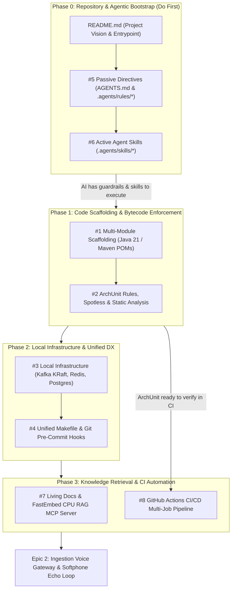

# Epic 1: Engineering Foundation, Tooling, & Agentic Workflow Setup

## 1. Executive Summary & Objective

Based on the blueprints defined in **[RFC-0001](file:///home/antigravity/pedrazamiguez/voice-pulse/RFC-0001-VOICEPULSE.md)** (Architecture Strategy), **[RFC-0002](file:///home/antigravity/pedrazamiguez/voice-pulse/RFC-0002-VOICEPULSE.md)** (AI Engineering, Tooling & Automation Blueprint), and **[RFC-0003](file:///home/antigravity/pedrazamiguez/voice-pulse/RFC-0003-VOICEPULSE.md)** (Business Scenario: International Airline Disruption Hotline), the VoicePulse platform requires a rock-solid engineering baseline before writing runtime audio streaming code.

### Why Epic 1 Comes First
Jumping directly into WebFlux WebSocket audio loops or Kafka producers without structural guardrails leads to:
1. **Architectural erosion**: Domain models inadvertently importing Netty, Spring, or Kafka dependencies.
2. **Resource & memory leaks**: Netty `ByteBuf` allocations escaping reference-counting checks.
3. **Inefficient AI interactions**: Agents consuming tens of thousands of tokens per prompt without AST code graphs or local documentation RAG.
4. **CI/CD bottlenecks**: Unstandardized builds, lack of automated bytecode checks, and missing pre-commit validation.

**Epic 1 Objective:** Establish the complete multi-module repository skeleton, bytecode-level architectural enforcement, local containerized infrastructure, unified developer ergonomics, and the local AI meta-system (guardrails, skills, and in-repo RAG).

---

## 2. Architecture & Dependency Flow (AI-First Execution)

To avoid the **Bootstrapping Paradox** (attempting to implement code without automated agent guardrails and SDD workflows), the repository meta-system (README, `AGENTS.md`, and active skills) is established in **Phase 0** prior to code scaffolding and local infrastructure.

---

## 3. Detailed Issue Breakdown

### Issue 1: Multi-Module Project Scaffolding & Build System
* **Title:** `feat(arch): initialize multi-module project scaffolding and build descriptors`
* **Labels:** `epic-1`, `architecture`, `foundation`
* **Target Branch:** `feature/VP-01-scaffolding` -> `develop`
* **Goal:** Create the root Maven build descriptor and module structure aligning with Hexagonal Architecture.
* **Scope & Deliverables:**
  - Root `pom.xml` configured for Java 21, Spring Boot 3.3.x, and Maven 3.9+.
  - Submodules declared:
    - `edge-gateway-service`: Reactive WebFlux / Netty WebSocket audio streaming edge.
    - `conversation-engine`: Hexagonal core state machine, VAD evaluation, and AI triage.
    - `routing-handoff-service`: Operator queueing, Redis presence, and ticket persistence.
    - `shared-kernel`: Pure domain value objects, identifiers (`call_id`, `pnr`), and cross-cutting sealed interfaces.
  - Dependency Management configuration:
    - Spring Boot Dependencies BOM.
    - Reactor Netty & Project Reactor.
    - Apache Kafka Clients & Spring Kafka.
    - Testcontainers BOM (Kafka KRaft, PostgreSQL).
    - ArchUnit (`com.tngtech.archunit:archunit-junit5:1.3.0`).
    - JUnit 5 (`org.junit.jupiter`), AssertJ (`assertj-core`), Mockito.
  - `.gitignore`, `.editorconfig`, and directory skeletons with `package-info.java` files.
* **Acceptance Criteria:**
  - [ ] `mvn clean compile` succeeds across all submodules.
  - [ ] Java 21 toolchain validation enforced in root POM.
  - [ ] No circular dependencies between modules.

---

### Issue 2: Architectural Testing & Static Analysis Guardrails
* **Title:** `feat(qa): implement ArchUnit rules, Spotless formatting, and compiler static analysis`
* **Labels:** `epic-1`, `architecture`, `tooling`
* **Target Branch:** `feature/VP-02-arch-guardrails` -> `develop`
* **Goal:** Prevent architectural regressions and code quality degradation at compile and test time.
* **Scope & Deliverables:**
  - **ArchUnit Test Suite** (`ArchitectureTest.java`):
    - Domain purity: `..domain..` classes must NOT depend on Spring, Netty, Kafka, Jackson, or Jakarta Persistence.
    - Port interfaces: Inbound and Outbound ports must be Java interfaces located in `..domain.ports..`.
    - Naming conventions: Inbound ports must end with `UseCase`; listeners must end with `Listener` or `Consumer`.
    - Safety checks: Prohibit field injection (`@Autowired` on fields) and prohibit `System.out`/`System.err` in favor of SLF4J structured logging.
    - File size guard: Production Java files must not exceed 600 lines.
  - **Spotless Plugin**:
    - Google Java Format (AOSP style, 4-space indent), automatic unused import removal, trailing whitespace trimming, final newline enforcement.
  - **Error Prone & SpotBugs**:
    - Integrated compiler flags for multithreading safety, null checks, and unclosed resources.
    - `config/spotbugs/exclude.xml` and `config/checkstyle/checkstyle.xml`.
* **Acceptance Criteria:**
  - [ ] `mvn test -Dtest=ArchitectureTest` passes.
  - [ ] `mvn spotless:check` and `mvn spotless:apply` format Java code cleanly.
  - [ ] ArchUnit fails builds if an illegal framework import is added to a domain package.

---

### Issue 3: Local Infrastructure Baseline (Docker Compose KRaft, Redis, Postgres)
* **Title:** `feat(infra): provision local Docker infrastructure with Kafka KRaft, Redis, and PostgreSQL`
* **Labels:** `epic-1`, `infrastructure`
* **Target Branch:** `feature/VP-03-local-infra` -> `develop`
* **Goal:** Provide a one-command local backing stack matching production topology.
* **Scope & Deliverables:**
  - `docker-compose.infra.yml`:
    - **Apache Kafka (KRaft mode)**: Confluent CP Kafka 7.6+ (single-node, no ZooKeeper).
    - Auto-provisioned topics:
      - `telephony.calls.raw` (partition key: `callId`, 12 partitions for parallel worker testing).
      - `telephony.calls.control` (signaling, cutoffs, barge-in interrupts).
      - `telephony.tickets.intent` (pre-handoff structured tickets).
      - `telephony.calls.dlq` (dead-letter queue).
    - **Redis 7 (Alpine)**: With healthchecks, persistence volume, and password-free local dev profile.
    - **PostgreSQL 16 (Alpine)**: Database `voicepulse`, user `voicepulse`, persistent volume.
    - Initialization script (`init-db.sql`) setting up tables with JSONB support for disruption tickets.
* **Acceptance Criteria:**
  - [ ] `docker compose -f docker-compose.infra.yml up -d` starts all 3 services healthy within 30 seconds.
  - [ ] Kafka topics are created automatically on container startup.
  - [ ] PostgreSQL accepts connections and mounts schemas cleanly.

---

### Issue 4: Developer Ergonomics & Unified CLI (Makefile & Pre-Commit Hooks)
* **Title:** `feat(dx): implement unified Makefile and Git pre-commit verification hooks`
* **Labels:** `epic-1`, `tooling`, `developer-experience`
* **Target Branch:** `feature/VP-04-developer-cli` -> `develop`
* **Goal:** Standardize developer workflows and prevent broken code from being committed.
* **Scope & Deliverables:**
  - **Unified `Makefile`**:
    - `make help`: Display targets with colors and documentation.
    - `make setup`: Bootstrap pre-commit hooks, start docker infrastructure, and initialize AI tooling.
    - `make fast-check`: Spotless check + ArchUnit tests in under 15 seconds.
    - `make check`: Full verification (compile, SpotBugs, JaCoCo, all tests).
    - `make arch-check`: ArchUnit test suite + 600-line file audit.
    - `make docker-infra`: Launch local Kafka, Redis, and Postgres.
    - `make doctor`: Validate environment requirements (Java 21, Docker, uv, Maven).
  - **Git Pre-commit Hook** (`scripts/pre-commit`):
    - Executes `make fast-check` on staged Java files prior to commit.
    - Blocks commit if formatting, ArchUnit, or line limits are violated.
* **Acceptance Criteria:**
  - [ ] `make setup` installs `.git/hooks/pre-commit` with executable permissions.
  - [ ] `make fast-check` runs cleanly and reports status with colored terminal output.
  - [ ] Staging an unformatted or rule-violating file causes `git commit` to abort.

---

### Issue 5: Passive Agent Guardrails & Architectural Directives
* **Title:** `feat(ai): define repository AGENTS.md and modular architecture rule guardrails`
* **Labels:** `epic-1`, `ai-workflow`, `documentation`
* **Target Branch:** `feature/VP-05-agent-guardrails` -> `develop`
* **Goal:** Provide deterministic instruction sets for AI coding assistants to prevent architectural drift.
* **Scope & Deliverables:**
  - Root `AGENTS.md`:
    - Strict Hexagonal Architecture rules (Domain Core purity, Port interfaces, Adapters).
    - Java 21 concurrency guidelines (Records for DTOs/events, sealed interfaces for state machines).
    - Netty `ByteBuf` allocation and memory safety rules (`ReferenceCountUtil.release`, zero leaks).
    - Kafka partitioning mandates (strictly partition by `callId`).
    - Airline Disruption Hotline business constraints (from RFC-0003: 25-word brevity rule, acoustic verification, MCP boundaries).
  - Modular rule files in `.agents/rules/`:
    - `01-hexagonal-architecture.md`
    - `02-java21-concurrency.md`
    - `03-netty-bytebuf-safety.md`
    - `04-kafka-partitioning.md`
* **Acceptance Criteria:**
  - [ ] `AGENTS.md` is present at repository root.
  - [ ] `.agents/rules/` contains all 4 focused rule documents.
  - [ ] Rules strictly align with ArchUnit assertions in `ArchitectureTest.java`.

---

### Issue 6: Active Agent Skills & SDD Workflow Automation
* **Title:** `feat(ai): implement active Specification-Driven Development (SDD) agent skills`
* **Labels:** `epic-1`, `ai-workflow`, `tooling`
* **Target Branch:** `feature/VP-06-agent-skills` -> `develop`
* **Goal:** Automate the 5-stage SDD lifecycle (Specification -> Architecture -> Domain TDD -> Infra -> Audit).
* **Scope & Deliverables:**
  - `.agents/skills/vp-plan-issue/SKILL.md`:
    - Inputs: Issue number.
    - Workflow: Pulls GitHub issue description, queries in-repo RAG, checks existing ports, outputs concrete file plan (`[NEW]`, `[MODIFY]`), and posts plan for human approval.
  - `.agents/skills/vp-start-issue/SKILL.md`:
    - Inputs: Issue number.
    - Workflow: Verifies branch naming, retrieves approved issue plan, checks 500-line pre-edit threshold, executes TDD loop (domain tests -> ports -> adapters), and runs `make fast-check`.
  - `.agents/skills/vp-verify-architecture/SKILL.md`:
    - Workflow: Runs ArchUnit, audits file line counts (`wc -l <= 600`), runs Spotless and SpotBugs.
  - Supporting skills: `vp-replan-issue`, `vp-address-sonar-issues`, `vp-address-pr-comments`.
* **Acceptance Criteria:**
  - [ ] All skill files contain valid YAML frontmatter (`name`, `description`, `arguments`).
  - [ ] Skill steps are reproducible and reference existing project scripts.

---

### Issue 7: Local Documentation Knowledge Base & In-Repo CPU ONNX RAG
* **Title:** `feat(rag): scaffold living documentation and in-repo FastEmbed CPU RAG indexer`
* **Labels:** `epic-1`, `ai-workflow`, `documentation`
* **Target Branch:** `feature/VP-07-local-rag` -> `develop`
* **Goal:** Enable zero-token-cost, private semantic search over project documentation for AI agents.
* **Scope & Deliverables:**
  - **Living Documentation Skeleton (`docs/`)**:
    - `docs/domain/`: Telephony invariants, airline disruption state machine diagrams, ticket JSONB schemas.
    - `docs/architecture/`: C4 diagrams, Kafka partition key topologies, Netty event-loop design.
    - `docs/engineering/`: Quality gates, testing pyramid, metrics SLOs.
  - **Local Python FastMCP RAG Stack**:
    - `scripts/rag_indexer.py`: Markdown chunker parsing `/docs/**/*.md` and `AGENTS.md`, computing CPU embeddings with `fastembed` (`BAAI/bge-small-en-v1.5`), and storing vectors in SQLite with FTS5.
    - `scripts/rag_mcp_server.py`: FastMCP stdio server exposing `search_project_knowledge(query)` and `get_doc_section(path, title)`.
    - `scripts/ai-setup.sh`: Automated script to install `uv`, build the index, and register the MCP server.
* **Acceptance Criteria:**
  - [ ] `uv run scripts/rag_indexer.py` generates `.cache/voicepulse_rag.db` without cloud API keys or GPU.
  - [ ] Hybrid BM25 + dense vector query returns relevant documentation snippets in under 100ms.
  - [ ] `scripts/ai-setup.sh` is idempotent and executable.

---

### Issue 8: GitHub Actions CI/CD Pipeline Suite & Automation
* **Title:** `ci: configure GitHub Actions multi-job pipeline, branch enforcement, and PR template`
* **Labels:** `epic-1`, `ci-cd`
* **Target Branch:** `feature/VP-08-ci-cd` -> `develop`
* **Goal:** Ensure all quality gates, tests, and formatting checks run automatically on every pull request.
* **Scope & Deliverables:**
  - `.github/workflows/static-analysis.yml`:
    - Spotless check (`mvn spotless:check`).
    - Compiler audit & SpotBugs check.
  - `.github/workflows/coverage-and-architecture.yml`:
    - ArchUnit tests execution (`mvn test -Dtest=ArchitectureTest`).
    - 600-line hard file limit verification script.
    - JaCoCo code coverage gate (80% domain gate).
  - `.github/workflows/build-and-test.yml`:
    - Unit tests and Testcontainers integration tests.
  - `.github/workflows/create-branch-from-issue.yml`:
    - Automatically creates `feature/VP-<id>` or `bugfix/VP-<id>` from `develop` when labeled.
  - `.github/pull_request_template.md`:
    - Standardized PR template with ArchUnit pass checkbox, line count validation, and test results.
* **Acceptance Criteria:**
  - [ ] Workflows trigger on PRs targeting `main` and `develop`.
  - [ ] Concurrency controls configured with `cancel-in-progress: true`.
  - [ ] Pull request template is automatically presented on new PR creation.

---

## 4. Work Breakdown & Execution Timeline (AI-First)

| Phase | Order | Issue / Task | Est. Scope | Primary Focus |
|:---|:---:|:---|:---:|:---|
| **Phase 0: Bootstrap** | **1** | **README.md & Vision Setup** | 0.25 day | Repo entrypoint, architecture map, quick links |
| | **2** | **#5 Passive Agent Directives (AGENTS.md)** | 0.5 day | Root `AGENTS.md`, `.agents/rules/*.md`, business rules |
| | **3** | **#6 Active Agent Skills (.agents/skills)** | 0.75 day | `vp-plan-issue`, `vp-start-issue`, `vp-verify-architecture` |
| **Phase 1: Scaffolding** | **4** | **#1 Multi-Module Project Scaffolding** | 1 day | Maven root POM, submodules, dependencies, directory tree |
| | **5** | **#2 Architectural Testing & Quality Guards** | 1 day | ArchUnit tests, Spotless config, Error Prone, SpotBugs |
| **Phase 2: Infra & DX** | **6** | **#3 Local Infrastructure (Docker Compose)** | 0.5 day | Kafka KRaft, Redis 7, Postgres 16, topic provisioner |
| | **7** | **#4 Developer Ergonomics (Makefile & Hooks)** | 0.5 day | Unified Makefile, git pre-commit hook, developer CLI |
| **Phase 3: Automation** | **8** | **#7 Local Documentation RAG & MCP Server** | 1 day | `docs/` skeleton, `scripts/rag_indexer.py`, FastMCP server |
| | **9** | **#8 GitHub Actions CI/CD Pipeline Suite** | 1 day | Workflows for static analysis, ArchUnit, JaCoCo, branch creation |

**Total Estimated Duration:** ~6-7 days of focused implementation, leaving the repository in an enterprise-grade state ready for Epic 2 (Edge Gateway & Browser Softphone).

---

## 5. Definition of Done for Epic 1

Epic 1 is considered **DONE** when:
1. `git clone` on a fresh machine followed by `make setup` completes without errors.
2. `make fast-check` runs Spotless and ArchUnit in under 15 seconds with zero violations.
3. `make check` builds all modules, passes all tests, and validates bytecode rules.
4. `docker compose -f docker-compose.infra.yml up -d` boots healthy Kafka, Redis, and Postgres containers.
5. All 8 GitHub issues are created, tracked, implemented via pull requests to `develop`, and merged.
